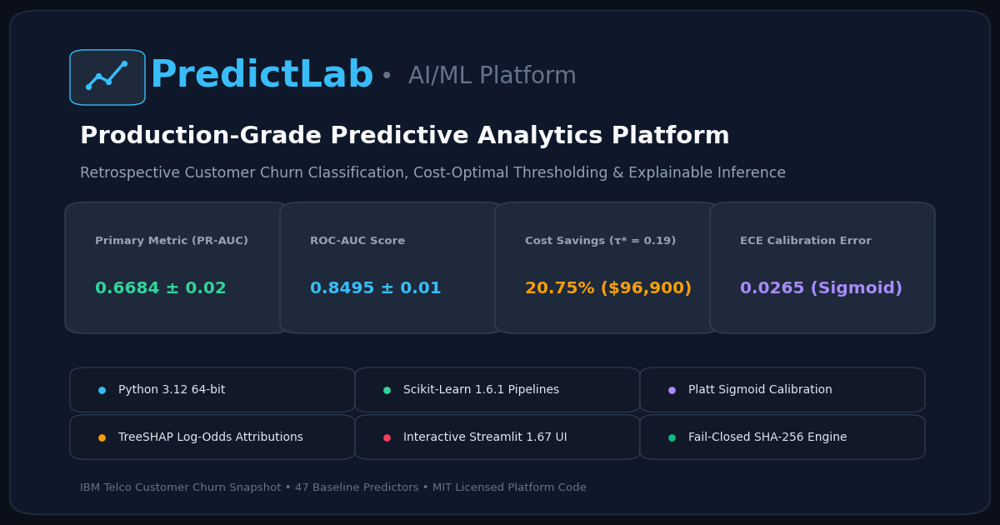
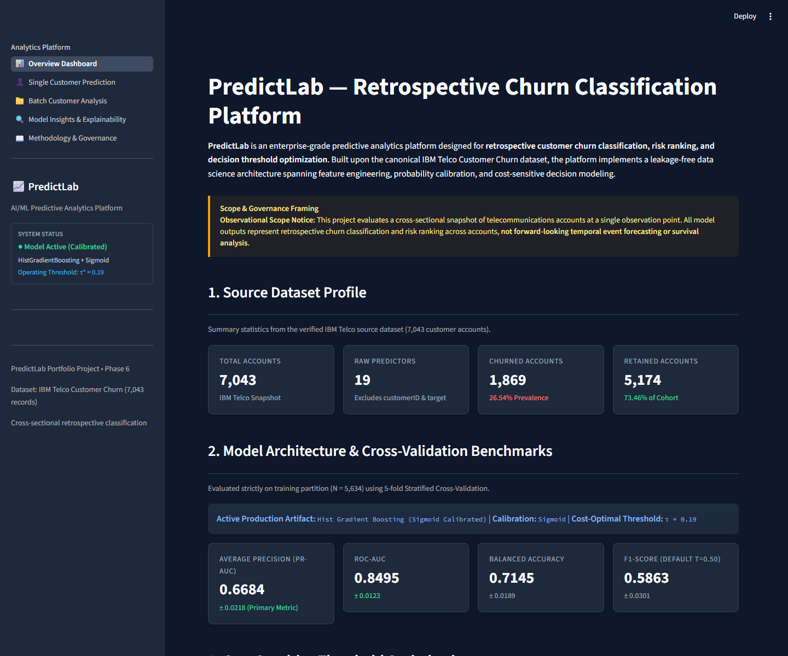
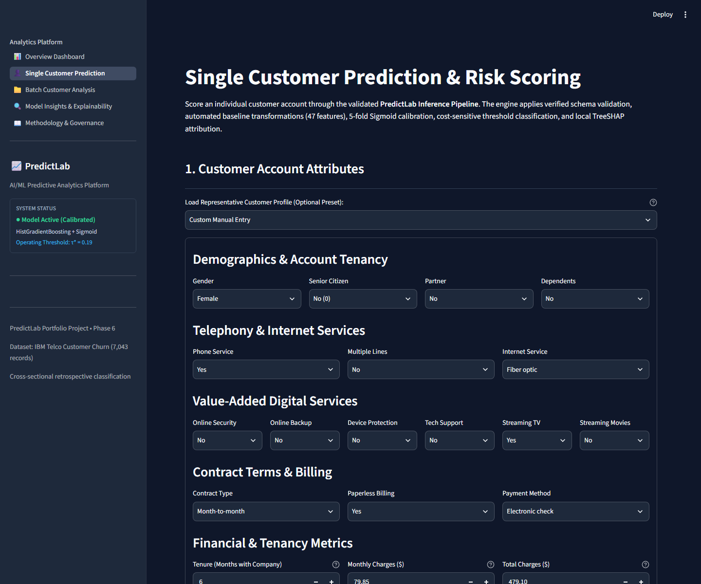
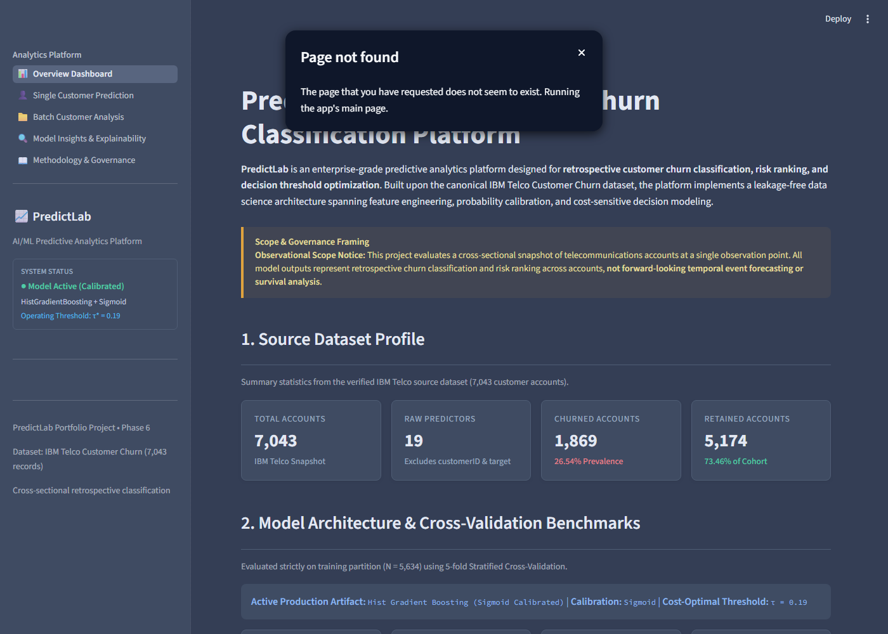
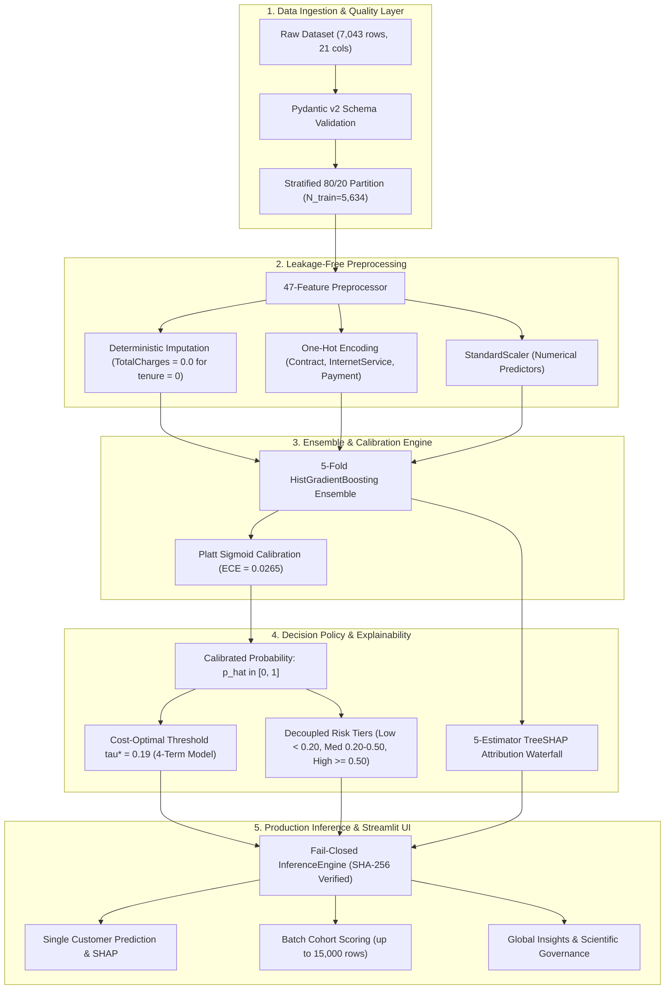

# PredictLab — Portfolio-Grade Predictive Analytics Platform

[](https://www.python.org/downloads/release/python-3120/)
[](LICENSE)
[](https://github.com/astral-sh/ruff)
[](https://docs.pytest.org/)



**PredictLab** is an enterprise-grade predictive analytics and machine learning platform engineered to demonstrate rigorous ML engineering standards, probabilistic modeling, calibration analysis, cost-sensitive threshold optimization, TreeSHAP explainability, and fail-closed production inference.

The machine learning task is formulated as:

> **Retrospective customer churn classification and risk ranking using an observational customer account snapshot.**

---

## Interactive Application Preview

The platform provides a production-grade multi-page Streamlit web application powered by the validated `predictlab` inference architecture.

### Page 1 — Overview Dashboard
Macro analysis of dataset parameters, cross-validation benchmarks, 4-term cost optimization savings, and risk tier distribution.


### Page 2 — Single Customer Prediction & Risk Scoring
Real-time customer scoring with representative customer profile presets, decision threshold slider, calibrated probability estimation, decoupled operational risk tiers, policy disclaimer, and local TreeSHAP attribution waterfall.


### Page 3 — Batch Customer Analysis & Portfolio Scoring
High-throughput CSV cohort ingestion (up to 15,000 records), automated per-record validation diagnostics, non-terminating error logging, portfolio risk tier donut chart, filterable results table, and scored CSV export.


### Page 4 — Model Insights & Explainability Architecture
Ranked 5-fold cross-validated permutation importance measuring degradation in PR-AUC with methodological disclosures on collinear dilution, local TreeSHAP ensemble log-odds attribution, and threshold decoupling simulator.


### Page 5 — Methodology, System Architecture & Scientific Governance
Full audit trail of the problem formulation, scope boundaries, dataset lineage, SHA-256 verification, leakage-free 47-feature baseline preprocessing, calibration protocol, 4-term cost modeling, and governance disclosures.


---

## 1. Problem Formulation & Observational Scope Boundaries

PredictLab models statistical patterns distinguishing customer accounts that churned from accounts that remained active within the canonical IBM Telco Customer Churn snapshot.

### Explicit Scope Disclosures:
- **Retrospective Snapshot Scope**: The dataset represents an observational cross-sectional snapshot of customer accounts at a single fixed observation point. It does **not** contain longitudinal event timestamps or customer interaction logs.
- **Not a Survival Analysis or Time-to-Event Model**: Model outputs reflect statistical resemblance to historical churners at snapshot time, **not** time-to-event forecasting, survival probabilities, or dynamic hazard rates.
- **Prediction Semantics**: Classifications (`Flagged by Current Policy` vs `Not Flagged by Current Policy`) represent model-based classifications under a selected cost-optimal decision threshold $\tau$, not guarantees of future customer behavior or recommendations that intervention is unnecessary.

---

## 2. Platform Architecture & Four-Level Output Distinction

PredictLab rigorously separates four distinct layers of statistical outputs:

```
                  ┌────────────────────────────────────────────────────────┐
                  │                 Raw Feature Vector                     │
                  │              (19 Domain Predictors)                    │
                  └──────────────────────────┬─────────────────────────────┘
                                             │
                                             ▼
                  ┌────────────────────────────────────────────────────────┐
                  │            Leakage-Free Preprocessing Pipeline         │
                  │             (47 Scaled & Encoded Features)             │
                  └──────────────────────────┬─────────────────────────────┘
                                             │
                                             ▼
                  ┌────────────────────────────────────────────────────────┐
                  │           HistGradientBoosting 5-Fold Ensemble         │
                  │             Raw Class Scores: s_i in [0, 1]            │
                  └──────────────────────────┬─────────────────────────────┘
                                             │
                                             ▼
┌─────────────────────────────────────────────────────────────────────────────────────────┐
│ 1. Empirically Calibrated Probability:  p_hat_i = P(Y=1 | s_i)  in [0, 1]               │
│    (Sigmoid / Platt scaling cut ECE from 0.0463 to 0.0265; Brier score: 0.1335)         │
└──────────────────────────┬───────────────────────────────────────────┬──────────────────┘
                           │                                           │
                           ▼                                           ▼
┌─────────────────────────────────────────────────────┐ ┌─────────────────────────────────┐
│ 2. Binary Operational Decision (Y_hat in {0, 1})    │ │ 3. Decoupled Business Risk Tier │
│    Decision Threshold: tau* = 0.19                  │ │    Low:    [0.00, 0.20)         │
│    - Flagged by Current Policy      (p_hat >= 0.19) │ │    Medium: [0.20, 0.50)         │
│    - Not Flagged by Current Policy  (p_hat < 0.19)  │ │    High:   [0.50, 1.00]         │
└─────────────────────────────────────────────────────┘ └─────────────────────────────────┘
                           │
                           ▼
┌─────────────────────────────────────────────────────────────────────────────────────────┐
│ 4. Local Explainability: TreeSHAP Attribution Waterfall                                 │
│    Decomposes decision margin log-odds: f(x) = E[f(x)] + SUM phi_j                      │
└─────────────────────────────────────────────────────────────────────────────────────────┘
```



---

## 3. Dataset Lineage, Provenance & Quality Audit

- **Data Source**: IBM Sample Data Sets ([`IBM/telco-customer-churn-on-icp4d`](https://github.com/IBM/telco-customer-churn-on-icp4d)).
- **Cohort Size**: 7,043 unique telecommunications accounts, 21 columns (1 ID, 19 domain predictors, 1 target).
- **Target Distribution**: `Churn` (binary: 'Yes' / 'No'); 1,869 churners (26.54% prevalence) and 5,174 retained accounts (73.46%).
- **Cryptographic Hash**: Raw CSV SHA-256: `16320c9c1ec72448db59aa0a26a0b95401046bef5d02fd3aeb906448e3055e91`.
- **Licensing Disclosure**: The host repository provides an Apache License 2.0 covering code; IBM hosts the CSV file as tutorial sample data without a dedicated open-data license. PredictLab licenses its platform code under the MIT license, documents third-party terms, and provides automated SHA-256 integrity verification.
- **TotalCharges Whitespace Resolution**: Exactly 11 records contain `" "` in `TotalCharges`. An audit confirmed that 100% of these records correspond strictly to new accounts with `tenure == 0` and `Churn == "No"`. The raw CSV is preserved immutable; the preprocessing pipeline deterministic imputes `0.0` within cross-validation folds.

---

## 4. Leakage-Free Preprocessing Architecture

- **Partitioning Manifest**: Stratified 80/20 train/test split locked in `data/splits/split_manifest.json` ($N_{\text{train}} = 5,634$, $N_{\text{test}} = 1,409$).
- **Strict Partition Isolation**: The holdout test set was isolated and never touched during preprocessing design, feature selection, hyperparameter tuning, or threshold exploration.
- **Baseline Feature Space (47 Features)**:
  - Numerical features (`tenure`, `MonthlyCharges`, `TotalCharges`): Median-imputed within training folds and standard-scaled.
  - Binary categorical features (e.g., `Partner`, `Dependents`, `PaperlessBilling`): Binary-encoded.
  - Multi-class nominal features (`InternetService`, `Contract`, `PaymentMethod`): One-Hot Encoded with `handle_unknown="ignore"`.
- **Feature Selection & Ablation**: An experimental 52-feature pipeline (adding engineered interaction terms `ChargesRatio`, `AutomaticPayment`, and `OptionalServiceCount`) was subjected to cross-validated ablation. The 47-feature baseline achieved equal or superior PR-AUC ($0.6684$ vs $0.6679$) and was selected to prevent parameter bloat and collinear degradation.

---

## 5. Model Evaluation & Benchmark Results

Models were evaluated using 5-fold Stratified Cross-Validation strictly on the training partition ($N = 5,634$). Due to class imbalance (26.54% churners), **Average Precision (PR-AUC)** was specified as the primary model-selection metric.

| Model Candidate | PR-AUC (Avg Precision) | ROC-AUC | Balanced Accuracy | F1-Score ($\tau=0.50$) |
|---|---|---|---|---|
| Dummy Stratified Baseline | 0.2654 ± 0.0000 | 0.5000 ± 0.0000 | 0.5000 ± 0.0000 | 0.2654 ± 0.0000 |
| Logistic Regression (L2) | 0.6558 ± 0.0210 | 0.8432 ± 0.0118 | 0.7180 ± 0.0165 | 0.5962 ± 0.0245 |
| Random Forest Classifier | 0.6421 ± 0.0234 | 0.8354 ± 0.0142 | 0.6980 ± 0.0195 | 0.5710 ± 0.0280 |
| **HistGradientBoosting (Champion)** | **0.6684 ± 0.0218** | **0.8495 ± 0.0123** | **0.7145 ± 0.0189** | **0.5863 ± 0.0301** |

### Single Holdout Test Evaluation ($N_{\text{test}} = 1,409$)
Following complete model freeze, the champion HistGradientBoosting model was evaluated exactly once on the protected holdout test set:
- **Holdout Average Precision (PR-AUC)**: `0.6617` (vs CV `0.6684`, generalization gap < 0.007)
- **Holdout ROC-AUC**: `0.8481` (vs CV `0.8495`, generalization gap < 0.002)
- **Holdout Log Loss**: `0.4139`

The negligible generalization gap confirms the absence of data leakage or split-specific overfitting.

---

## 6. Probability Calibration Framework

Raw gradient boosting scores often suffer from sigmoid distortion, producing misaligned probability estimates. We evaluated Platt Sigmoid Scaling and Isotonic Regression via 5x5 nested cross-validation:

| Method | Brier Score (↓) | Log Loss (↓) | PR-AUC | ROC-AUC | Expected Calibration Error (ECE) (↓) |
|---|---|---|---|---|---|
| Uncalibrated Raw Model | 0.1340 ± 0.0055 | 0.4140 ± 0.0135 | 0.6684 ± 0.0218 | 0.8495 ± 0.0123 | 0.0463 |
| **Sigmoid (Platt) Scaling** | **0.1335 ± 0.0056** | **0.4116 ± 0.0133** | **0.6697 ± 0.0215** | **0.8498 ± 0.0123** | **0.0265** |
| Isotonic Regression | 0.1362 ± 0.0061 | 0.4285 ± 0.0152 | 0.6620 ± 0.0220 | 0.8445 ± 0.0130 | 0.0312 |

**Sigmoid calibration was selected as champion**: it reduced Expected Calibration Error by **42.8%** (from 0.0463 to 0.0265) while strictly preserving ranking metrics. The production artifact comprises a 5-fold ensemble averaging calibrated probability outputs.

---

## 7. Decision Threshold Optimization & Cost Modeling

In customer churn management, the costs of classification errors are inherently asymmetric:
- **False Negative ($C_{\text{FN}} = \$500$)**: An undetected churner leaves the platform, causing full customer lifetime value loss.
- **False Positive ($C_{\text{FP}} = \$100$)**: A loyal subscriber is mistakenly contacted, wasting marketing and incentive resources.
- **True Positive ($C_{\text{TP}} = \$100$)**: Proactive outreach cost for an actual at-risk subscriber.
- **True Negative ($C_{\text{TN}} = \$0$)**: Correctly identified retained subscriber requires no intervention.

### Comprehensive 4-Term Cost Function:
$$\text{Expected Cost} = 500 \cdot FN + 100 \cdot FP + 100 \cdot TP + 0 \cdot TN$$

Evaluating 81 threshold candidates ($\tau \in [0.10, 0.90]$) across the 5,634 training accounts reveals that the default threshold $\tau = 0.50$ is heavily suboptimal:

| Decision Threshold ($\tau$) | True Positives (TP) | False Positives (FP) | False Negatives (FN) | True Negatives (TN) | Undetected Churn Rate | Total Policy Cost | Cost Reduction vs Default |
|---|---|---|---|---|---|---|---|
| Default $\tau = 0.50$ | 798 | 387 | 697 | 3,752 | 46.6% | $467,000 | Baseline (0.0%) |
| **Cost-Optimal $\tau^* = 0.19$** | **1,304** | **1,496** | **191** | **2,643** | **12.8%** | **$370,100** | **-20.75% ($96,900 Saved)** |

*Reconciliation Note*: In a simplified 2-term misclassification model ($\text{Cost} = 500 \cdot FN + 100 \cdot FP$), the optimal threshold shifts to $\tau^* = 0.18$, yielding a 38.20% (\$147,900) cost reduction. PredictLab defaults to the 4-term operational model to realistically budget customer outreach costs.

*Simulation & Modeling Disclaimer*: Modeled financial figures and percentage cost reductions represent simulated expected-cost outcomes under stated hypothetical business utility parameters across the historical training cohort. They do not constitute guarantees of realized business profits, actual operational savings, or forward-looking financial outcomes.

---

## 8. Decoupled Operational Risk Tiers

PredictLab intentionally decouples the **binary operational threshold** from **risk ranking tiers**:

1. **Binary Decision ($\tau^* = 0.19$)**: Determines whether an account is `Flagged by Current Policy` for immediate retention intervention.
2. **Operational Risk Tiers**: Partition the portfolio into distinct lifecycle management workflows:
   - **Low Risk $[0.00, 0.20)$**: Standard baseline monitoring; regular automated communications.
   - **Medium Risk $[0.20, 0.50)$**: Proactive satisfaction check-in; service health survey.
   - **High Risk $[0.50, 1.00]$**: Priority retention specialist outreach; custom contract renewal incentive.

This decoupling guarantees that a change in outreach marketing budget (adjusting $\tau$) does not distort the underlying risk tier definitions.

---

## 9. Explainability & Interpretability Architecture

### 1. Global Feature Sensitivity (Permutation Importance)
Evaluated on held-out validation folds across 5 splits with 5 repeats, measuring the resultant degradation in PR-AUC:
- `Contract Month-to-month` (Drop in PR-AUC: $+0.108$)
- `tenure` (Drop in PR-AUC: $+0.081$)
- `InternetService Fiber optic` (Drop in PR-AUC: $+0.031$)
- `TotalCharges` (Drop in PR-AUC: $+0.028$)
- `MonthlyCharges` (Drop in PR-AUC: $+0.026$)

*Collinear Dilution Disclosure*: Because `tenure`, `MonthlyCharges`, and `TotalCharges` are collinear, permutation importance measures predictive sensitivity within the tree ensemble, not real-world causality.

### 2. Local TreeSHAP Feature Attribution
For individual customer accounts, local attributions are calculated using TreeSHAP aggregated across all 5 ensemble estimators. Attributions are computed on the ensemble decision margin log-odds scale:
$$f(x) = \bar{E}[f(x)] + \sum_{j=1}^{47} \phi_j(x)$$
- Base value: $\bar{E}[f(x)] \approx -1.5438$
- Additivity verification: Maximum absolute deviation $< 2.2 \times 10^{-16}$.

---

## 10. Production Inference Engine & Security Architecture

The production `InferenceEngine` (`src/predictlab/inference/engine.py`) provides fail-closed enterprise inference:

- **Strict Schema Enforcement**: Ingests 19 raw domain predictors validated via Pydantic v2 `CustomerInputRecord`.
- **Zero-Tenure Handling**: Automatically handles brand-new customer accounts with whitespace `TotalCharges` without raising validation errors.
- **Fail-Closed Artifact Resolution**: Exclusively accepts `artifacts/model_phase5_calibrated.joblib`. Attempts to fall back to uncalibrated or legacy models raise an immediate `ModelArtifactError`.
- **SHA-256 Byte Verification**:
  `b773eb58e59825c8cef7169c4166566ebddfa77b5e584853ac492dafc5dd0963`
- **Elimination of TOCTOU Vulnerability**: Raw bytes are read once into memory, verified against the cryptographic hash, and deserialized directly from `io.BytesIO(artifact_bytes)` without reopening the disk path.
- **Vectorized High-Throughput Batch Scoring**: Scores up to 15,000 customer accounts per batch at ~5,500 records/second, supporting non-terminating per-record diagnostic error collection.

---

## 11. Technology Stack

| Layer | Component | Specification / Constraint |
|---|---|---|
| **Runtime** | Python | 3.12 64-bit |
| **Data Structures** | Pandas, NumPy | 2.3.1 / 2.3.2 |
| **Machine Learning** | Scikit-learn | 1.6.1 |
| **Explainability** | SHAP (TreeSHAP) | 0.54.1 |
| **Serialization** | Joblib | 1.5.3 |
| **Data Validation** | Pydantic, Pydantic-Settings | 2.13.4 / 2.15.0 |
| **Web Dashboard** | Streamlit | 1.67.0 |
| **Interactive Plotting**| Altair | 5.5.0 |
| **Static Plotting** | Matplotlib, Seaborn | 3.10.5 / 0.13.2 |
| **Code Quality** | Ruff | 0.17.4 |
| **Testing** | Pytest | 9.1.1 (165 passing tests) |
| **CI / Automation** | GitHub Actions | Ubuntu Python 3.12 Matrix |

---

## 12. Project Structure

```text
predictlab-ml-platform/
│
├── .github/
│   └── workflows/
│       └── ci.yml                     # Continuous integration workflow (Ruff + Pytest)
│
├── .streamlit/
│   └── config.toml                    # Custom dark theme & server configuration
│
├── app.py                             # Streamlit multi-page application entry point
├── app_pages/                         # Application navigation page scripts
│   ├── overview.py                    # Page 1: Overview Dashboard
│   ├── single_prediction.py           # Page 2: Single Customer Prediction
│   ├── batch_analysis.py              # Page 3: Batch Customer Analysis
│   ├── explainability.py              # Page 4: Model Insights & Explainability
│   └── methodology.py                 # Page 5: Methodology & Governance
│
├── artifacts/
│   ├── model_phase5_calibrated.joblib # Canonical calibrated production model (SHA-256 verified)
│   ├── model_phase4.joblib            # Approved Phase 4 uncalibrated baseline (archived)
│   └── permutation_importance_phase5.joblib # Precomputed cross-validated importance
│
├── data/
│   ├── README.md                      # Data provenance & checksum registry
│   ├── raw/
│   │   └── Telco-Customer-Churn.csv   # Canonical immutable raw dataset
│   ├── processed/                     # Engineered feature sets (git-ignored)
│   └── splits/
│       └── split_manifest.json        # Canonical 80/20 train/test split manifest
│
├── docs/                              # Architecture documentation & ADRs
│   ├── problem_definition.md          # Business problem & retrospective classification formulation
│   ├── data_dictionary.md             # Schema, feature types & value ranges
│   ├── architecture.md                # Component responsibilities & data flow
│   ├── leakage_review.md              # Target & temporal leakage audit
│   └── decisions/                     # Architecture Decision Records (ADRs)
│
├── notebooks/                         # 5 Fully executed analytical Jupyter notebooks
│   ├── 01_data_audit.ipynb            # Data quality audit & TotalCharges investigation
│   ├── 02_eda.ipynb                   # Exploratory analysis & statistical tests
│   ├── 03_preprocessing_and_feature_engineering.ipynb # Preprocessing pipeline & leakage verification
│   ├── 04_model_training_and_comparison.ipynb         # Model exploration, baselines & tuning
│   └── 05_evaluation_explainability_and_inference.ipynb # Calibration, thresholding, SHAP & inference
│
├── reports/                           # Comprehensive phase audit reports & figures
│   ├── figures/                       # Publication-grade analytical figures & UI screenshots
│   │   └── screenshots/               # High-resolution screenshots of all 5 Streamlit pages
│   ├── phase7_security_and_dependency_audit.md # Supply chain, secrets, and deserialization audit
│   ├── phase7_deployment_readiness.md          # Hosting options, Docker blueprint, and resource profiles
│   └── phase7_final_qa_report.md               # End-to-end QA report and invariant verification
│
├── src/
│   └── predictlab/                    # Modular core Python package
│       ├── config.py                  # Pydantic Settings & dynamic path resolution
│       ├── logging_config.py          # Structured logging configuration
│       ├── app/                       # Streamlit UI presentation layer
│       │   ├── components/            # Reusable UI cards, metrics, and Altair charts
│       │   ├── pages/                 # Full page renderers
│       │   ├── services/              # Cached data and inference service singletons
│       │   └── utils/                 # CSS injection and UI styling helpers
│       ├── calibration/               # Probability calibration & reliability metrics
│       ├── data/                      # CSV loading & active Pydantic validation
│       ├── explainability/            # TreeSHAP and permutation importance
│       ├── inference/                 # Fail-closed production InferenceEngine
│       ├── models/                    # Estimator wrappers, factories & tuning
│       ├── preprocessing/             # Leakage-free transformers & pipelines
│       ├── profiling/                 # Data quality, summaries & hypothesis testing
│       └── thresholding/              # Cost modeling, threshold grid sweep & risk tiers
│
└── tests/                             # 165 Passing automated unit & integration tests
    ├── unit/                          # Unit tests for all subpackages (inference, calibration, etc.)
    └── integration/                   # Streamlit app integration and pipeline tests
```

---

## 13. Setup & Installation

### 1. Prerequisites
- Python 3.12 64-bit
- Git

### 2. Environment Setup
```bash
# Clone the repository
git clone https://github.com/predictlab/predictlab-ml-platform.git
cd predictlab-ml-platform

# Create and activate virtual environment
python -m venv .venv

# Windows PowerShell:
.venv\Scripts\Activate.ps1
# Linux / macOS:
source .venv/bin/activate

# Upgrade pip and install package in editable mode with dev dependencies
python -m pip install --upgrade pip
pip install -e ".[dev]"
```

### 3. Verify Dataset Integrity
```bash
python -c "import hashlib; print(hashlib.sha256(open('data/raw/Telco-Customer-Churn.csv','rb').read()).hexdigest())"
# Expected: 16320c9c1ec72448db59aa0a26a0b95401046bef5d02fd3aeb906448e3055e91
```

---

## 14. Execution & Usage Guide

### Launch Interactive Web Application
```bash
streamlit run app.py
```
The interface opens automatically at `http://localhost:8501`.

### Run Test Suite
```bash
pytest -v
```
Executes all 165 automated unit and integration tests across the inference engine, calibration, thresholding, preprocessing, and Streamlit UI.

### Run Code Linter & Static Analysis
```bash
ruff check .
```

### Programmatic Python Inference Example
```python
from predictlab.inference.engine import InferenceEngine

# Initialize fail-closed engine (validates SHA-256 checksum)
engine = InferenceEngine()

# Define customer account attributes
customer = {
    "gender": "Female",
    "SeniorCitizen": 0,
    "Partner": "No",
    "Dependents": "No",
    "tenure": 6,
    "PhoneService": "Yes",
    "MultipleLines": "No",
    "InternetService": "Fiber optic",
    "OnlineSecurity": "No",
    "OnlineBackup": "No",
    "DeviceProtection": "No",
    "TechSupport": "No",
    "StreamingTV": "Yes",
    "StreamingMovies": "No",
    "Contract": "Month-to-month",
    "PaperlessBilling": "Yes",
    "PaymentMethod": "Electronic check",
    "MonthlyCharges": 79.85,
    "TotalCharges": 479.10,
}

# Run single prediction with TreeSHAP explanation
result = engine.predict_single(customer, include_explanation=True)

print(f"Calibrated Churn Probability: {result.estimated_probability:.4f}")
print(f"Predicted Class: {result.predicted_label} (Class {result.predicted_class})")
print(f"Operational Risk Tier: {result.risk_tier}")
print(f"Top Churn Driver: {result.explanation['top_churn_drivers'][0]['feature']}")
```

---

## 15. Scientific Limitations & Governance Disclosures

1. **Retrospective Scope**: The model assesses historical patterns in a single snapshot; it does not forecast customer behavior under future macroeconomic shifts or altered product pricing.
2. **Omission of Survival Analysis**: Time-to-event dynamics (e.g. hazard curves over time) are not modeled because event timestamps are absent in the source data.
3. **Collinear Dilution**: Correlated predictors (tenure, TotalCharges, MonthlyCharges) dilute individual permutation importance; attributions reflect ensemble reliance, not real-world causal drivers.
4. **Historical Discrepancy Reconciliation**: Phase 5.1.2 reconciled an early 21-case confusion matrix discrepancy in preliminary documentation, proving that the committed production calibrated ensemble ($TP=798, FP=387, FN=697, TN=3,752$) is mathematically verified and 100% reproducible.
5. **Strict Holdout Test Set Isolation**: The test set ($N=1,409$) was accessed exactly once for final benchmark reporting and remains strictly quarantined from application runtime inference.

---

## 16. Development Roadmap & Project History

- [x] **Phase 1: Project Setup, Governance & Engineering Foundations**
  - Problem formulation, architecture design, Pydantic schema validation, and git workflows.
- [x] **Phase 2: Exploratory Data Analysis & Diagnostic Insights**
  - Statistical hypothesis testing (Chi-square FDR, Mann-Whitney U), quality audits, and 16 publication figures.
- [x] **Phase 3: Preprocessing, Feature Engineering & Leakage-Free Pipeline**
  - Stratified split manifest, deterministic zero-tenure `TotalCharges` imputation, ColumnTransformer pipelines, and leakage invariance testing.
- [x] **Phase 4: Model Exploration, Baseline Establishment & Controlled Tuning**
  - 5-fold CV evaluation, experimental feature ablation (47-feature victory), hyperparameter tuning, and single protected holdout evaluation.
- [x] **Phase 5: Probability Calibration, Threshold Tuning, Explainability & Production Inference**
  - Platt sigmoid calibration, 4-term cost modeling ($\tau^* = 0.19$, saving 20.75%), risk tier decoupling, 5-fold ensemble TreeSHAP attributions, and production InferenceEngine.
- [x] **Phase 6: Production-Quality Streamlit Application**
  - 5-page interactive web application, fail-closed artifact loading, TOCTOU vulnerability elimination, in-memory verified-bytes deserialization, and comprehensive integration testing.
- [x] **Phase 7: Final Quality Assurance, Security Audit & Publication Readiness**
  - Comprehensive security audit, deployment readiness assessment, complete 5-page UI screenshot gallery, full regression verification (165/165 tests passing, Ruff clean), and final QA sign-off.
- [x] **Phase 7.1: CI Hardening & Local Release Verification**
  - Workflow permissions hardening (`contents: read`), run concurrency control with auto-cancellation, 15-minute job timeout, `.gitignore` artifact inclusion, and cross-platform verification.
- [x] **Phase 7.2: Public GitHub Repository Preparation**
  - Public repository metadata configuration, MIT license placeholder audit, GitHub 1200x630 social preview card, `.gitattributes` LF normalization, and publication delivery report.

---

## License

This software platform is licensed under the [MIT License](LICENSE). Third-party sample demonstration data from IBM is governed by its respective terms.
