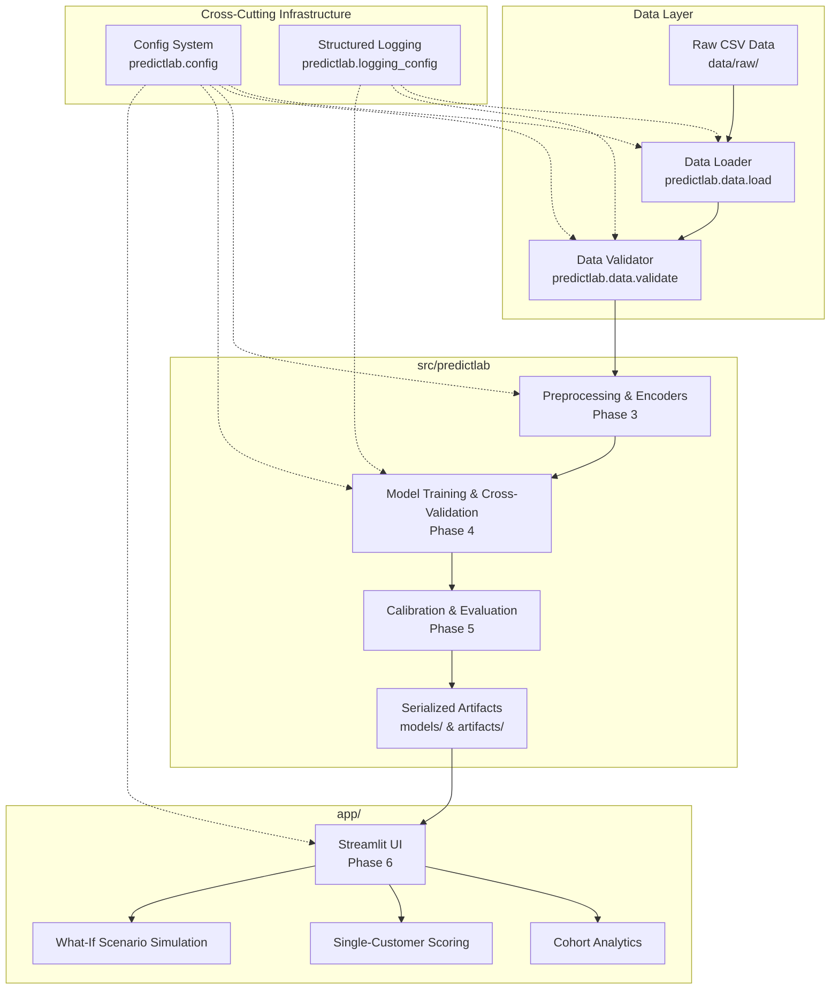

# PredictLab Architecture Specification

## 1. System Overview

PredictLab is engineered as a modular, production-ready predictive analytics platform. It adheres to strict separation of concerns, ensuring machine learning pipelines, data validation, and business logic remain completely decoupled from user presentation interfaces.



---

## 2. Directory Layout & Module Responsibilities

```text
predictlab-ml-platform/
│
├── .github/workflows/          # CI automation (linting, automated tests)
├── .streamlit/                 # UI presentation themes and server settings
├── data/
│   ├── raw/                    # Immutable raw source data
│   ├── processed/              # Transformed feature sets (git-ignored)
│   └── README.md               # Data registry & integrity documentation
├── docs/                       # Technical architecture, data dictionaries, ADRs
│   ├── architecture.md
│   ├── problem_definition.md
│   ├── data_dictionary.md
│   ├── leakage_review.md
│   └── decisions/
├── src/predictlab/             # Core Python package (business & ML logic)
│   ├── config.py               # Central configuration & dynamic path resolution
│   ├── logging_config.py       # Application logging
│   └── data/                   # Data ingestion and schema validation
│       ├── load.py
│       └── validate.py
├── app/                        # Streamlit web application (Phase 6)
├── models/                     # Serialized model binaries (.joblib)
├── artifacts/                  # Serialized transformers, metrics, and figures
├── reports/                    # Generated evaluation summaries and figures
├── tests/                      # Automated test suite
│   ├── fixtures/               # Deterministic synthetic test data
│   ├── unit/                   # Isolated component tests
│   └── integration/            # End-to-end data pipeline tests
├── pyproject.toml              # Build, dependencies, pytest, and ruff settings
└── README.md                   # Platform documentation
```

---

## 3. Core Module Responsibilities

### A. Configuration (`predictlab.config`)
- **Single Source of Truth**: Dynamically resolves project root and all asset directories without hardcoding machine-specific absolute paths.
- **Environment Overrides**: Powered by `pydantic-settings` to enable seamless continuous integration, local testing, and staging environment variable overrides.
- **Domain Constants**: Holds canonical schema specifications, target column naming, and class definitions.

### B. Logging (`predictlab.logging_config`)
- **Structured Standard Formatting**: Timestamps, log levels, file/function/line coordinates, and clean messages.
- **Idempotency**: Prevents duplicate handlers when imported across test runners, batch workers, and interactive Streamlit sessions.
- **Safety**: Strictly avoids logging personal identifiers or raw sensitive payload data.

### C. Ingestion & Validation (`predictlab.data.load` & `predictlab.data.validate`)
- **Immutability**: Ingestion functions return isolated copies, leaving raw source files untouched.
- **Strict Error Boundaries**: Handles missing files, 0-byte corruptions, and parsing failures gracefully with domain-specific exceptions (`DataValidationError`, `EmptyDatasetError`, etc.).
- **Pydantic Validation Reports**: Validation functions produce strongly-typed `ValidationResult` objects documenting row counts, schema fidelity, target class distributions, and duplicate rates.

---

## 4. Separation of ML Logic and User Interface

A critical architectural principle of PredictLab is the **absolute isolation between the ML pipeline and the UI layer**:
- **No Streamlit Code in `src/predictlab/`**: Core algorithms, data loaders, preprocessors, and inference pipelines must run in headless environments (CLI, CI, scheduled jobs) without any dependency on Streamlit.
- **No ML Logic in `app/`**: The Streamlit interface acts exclusively as a consumer of `predictlab` APIs and serialized joblib artifacts.
- **State Isolation**: User interactions in the UI cannot mutate underlying data assets or trained model binaries.
