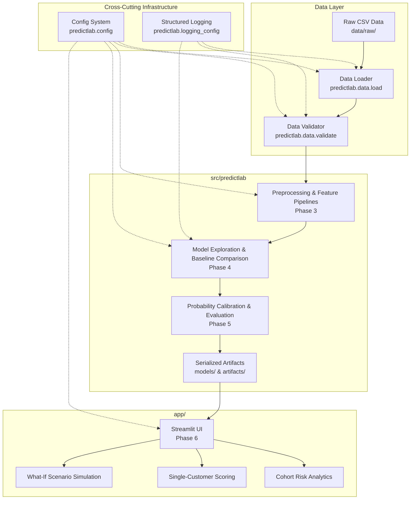

# PredictLab Architecture Specification

## 1. System Overview

PredictLab is engineered as a modular, production-grade predictive analytics platform. It adheres to strict separation of concerns, ensuring machine learning pipelines, data validation, and business logic remain completely decoupled from user presentation interfaces.



---

## 2. Directory Layout & Module Responsibilities

```text
predictlab-ml-platform/
│
├── .github/workflows/          # CI automation (linting, automated tests)
├── .streamlit/                 # UI presentation themes and server settings
├── data/
│   ├── raw/                    # Immutable raw source data
│   ├── processed/              # Transformed feature sets (git-ignored)
│   └── README.md               # Data registry & provenance documentation
├── docs/                       # Technical architecture, data dictionaries, ADRs
│   ├── architecture.md
│   ├── problem_definition.md
│   ├── data_dictionary.md
│   ├── leakage_review.md
│   └── decisions/
├── src/predictlab/             # Core Python package (business & ML logic)
│   ├── config.py               # Central configuration & dynamic path resolution
│   ├── logging_config.py       # Application logging
│   ├── data/                   # Data ingestion and schema validation
│   │   ├── load.py
│   │   └── validate.py
│   ├── profiling/              # Profiling, quality auditing, and diagnostic insights (Phase 2)
│   │   ├── __init__.py
│   │   ├── quality.py          # Data quality audit & TotalCharges anomaly investigation
│   │   ├── summary.py          # Univariate numeric and categorical summaries
│   │   ├── insights.py         # Segment churn rates, Chi-square & Mann-Whitney tests
│   │   └── visuals.py          # Publication-grade visual figure generation
│   ├── preprocessing/          # Leakage-free preprocessing, feature engineering & pipelines (Phase 3)
│   │   ├── __init__.py
│   │   ├── schema.py           # Feature definitions, contracts & domain boundaries
│   │   ├── cleaning.py         # Deterministic TotalCharges cleaning & zero-tenure validation
│   │   ├── feature_engineering.py # OptionalServiceCount, AutomaticPayment & ChargesRatio
│   │   ├── transformers.py     # Scikit-learn compatible custom transformers
│   │   ├── split.py            # Stratified holdout partitioning & manifest persistence
│   │   └── pipelines.py        # Linear and tree ColumnTransformer pipeline factories
│   └── models/                 # Model benchmarking, tuning, ablation & selection (Phase 4)
│       ├── __init__.py
│       ├── baselines.py        # DummyClassifier benchmarks (prior, most_frequent)
│       ├── estimators.py       # Candidate model factories (LR, RF, HistGradientBoosting)
│       ├── evaluation.py       # Multi-metric evaluation (PR-AUC, ROC-AUC, F1, Log Loss)
│       ├── cross_validation.py # Leakage-free Stratified 5-Fold cross-validation
│       ├── experiments.py      # Benchmark runner & feature ablation studies
│       ├── tuning.py           # Controlled hyperparameter tuning on training partition
│       ├── selection.py        # Objective model selection & holdout evaluation
│       └── persistence.py      # Artifact bundle and experiment JSON serialization
├── app/                        # Streamlit web application (Phase 6)
├── models/                     # Serialized model binaries (Phase 4-5)
├── artifacts/                  # Serialized transformers, metrics, and figures
├── reports/                    # Generated evaluation summaries and figures
├── tests/                      # Automated test suite
│   ├── fixtures/               # Deterministic synthetic test data
│   ├── unit/                   # Isolated component tests
│   └── integration/            # End-to-end data pipeline tests
├── pyproject.toml              # Build, dependencies, pytest, and ruff settings
└── README.md                   # Platform documentation
```

---

## 3. Core Module Responsibilities

### A. Configuration (`predictlab.config`)
- **Single Source of Truth**: Dynamically resolves project root and all asset directories without hardcoding machine-specific absolute paths.
- **Environment Overrides**: Powered by `pydantic-settings` to enable seamless continuous integration, local testing, and staging environment variable overrides.
- **Domain Constants**: Holds canonical schema specifications, target column naming, and class definitions.

### B. Logging (`predictlab.logging_config`)
- **Structured Standard Formatting**: Timestamps, log levels, file/function/line coordinates, and clean messages.
- **Idempotency**: Prevents duplicate handlers when imported across test runners, batch workers, and interactive Streamlit sessions.
- **Safety**: Strictly avoids logging personal identifiers or raw sensitive payload data.

### C. Ingestion & Validation (`predictlab.data.load` & `predictlab.data.validate`)
- **Immutability**: Ingestion functions return isolated copies, leaving raw source files untouched.
- **Strict Error Boundaries**: Handles missing files, 0-byte corruptions, duplicate CSV headers, and parsing failures gracefully with domain-specific exceptions (`DataValidationError`, `EmptyDatasetError`, `DuplicateColumnsError`, etc.).
- **Active Pydantic Validation**: Validation functions produce strongly-typed `ValidationResult` objects with active consistency validation (ensuring validity flags, error lists, and row bounds remain strictly synchronized).

### D. Profiling & Diagnostic Insights (`predictlab.profiling`)
- **Data Quality Auditing (`quality.py`)**: Automates deep structural quality scans, whitespace detection, and dedicated empirical audits of anomalous attributes (such as the 11 zero-tenure `TotalCharges` records).
- **Statistical Summaries (`summary.py`)**: Calculates robust distribution statistics (mean, median, IQR, skewness) and categorical frequency tables without mutating raw inputs.
- **Inferential Testing (`insights.py`)**: Computes segment churn rates, Chi-square tests of independence with Benjamini-Hochberg False Discovery Rate (FDR) adjustments, bias-corrected Cramér's V, Mann-Whitney U, and Welch's t-tests.
- **Visualization Suite (`visuals.py`)**: Generates 16 publication-grade figures saved to `reports/figures/` for exploratory reporting and notebook integration.

### E. Preprocessing & Feature Engineering (`predictlab.preprocessing`)
- **Dataset Partitioning (`split.py`)**: Executes 80/20 stratified holdout partitioning, target extraction, identifier removal, and lightweight manifest serialization (`split_manifest.json`).
- **Data Cleaning (`cleaning.py`)**: Implements strict `TotalCharges` whitespace-to-NaN parsing, zero-tenure validation guardrails, and $0.0$ domain imputation.
- **Feature Engineering (`feature_engineering.py`)**: Implements domain feature extraction (`OptionalServiceCount`, `AutomaticPayment`, and experimental `ChargesRatio`).
- **Custom Transformers (`transformers.py`)**: Exposes scikit-learn compatible transformers (`TotalChargesCleaner`, `OptionalServiceCounter`, `ColumnDropper`, etc.) with `get_feature_names_out()`.
- **Pipeline Factories (`pipelines.py`)**: Assembles production `ColumnTransformer` pipelines for both linear models (with standardization) and tree models (preserving natural units). Includes Joblib serialization utilities.

### F. Modeling, Evaluation & Selection (`predictlab.models`)
- **Baseline Establishment (`baselines.py`)**: Implements DummyClassifier benchmarks (`prior`, `most_frequent`, `stratified`) wrapped in uniform scikit-learn pipelines.
- **Candidate Model Factories (`estimators.py`)**: Encapsulates pipeline composition for Logistic Regression (L1/L2), Random Forest (unconstrained, constrained, balanced), and Histogram Gradient Boosting.
- **Multi-Metric Evaluation (`evaluation.py`)**: Computes ranking metrics (Average Precision / PR-AUC, ROC-AUC), classification metrics (F1, Precision, Recall, Balanced Accuracy), and probabilistic loss (Log Loss, Brier Score), alongside confusion matrices and curve coordinates.
- **Leakage-Free Cross-Validation (`cross_validation.py`)**: Enforces fold-level pipeline fitting using stratified 5-fold CV, tracking mean, standard deviation, fit times, and warnings.
- **Experimental Ablation (`experiments.py`)**: Empirically benchmarks candidate model families and executes controlled feature ablation comparing the 47-feature baseline against the 52-feature experimental pipeline.
- **Controlled Tuning (`tuning.py`)**: Executes bounded hyperparameter search on the training partition only using PR-AUC as the primary optimization target.
- **Model Selection & Holdout Evaluation (`selection.py`)**: Programmatically selects the optimal candidate based on multi-criteria ranking and executes a single holdout evaluation on the protected test partition.
- **Persistence (`persistence.py`)**: Serializes experiment reports to `reports/experiments/` and bundles the final fitted pipeline with complete provenance metadata to `artifacts/model.joblib`.

---

## 4. Probabilistic Modeling Terminology & Phased Governance

To avoid methodological ambiguity, PredictLab enforces precise distinctions across model outputs:

1. **Model-Estimated Class Probabilities (Uncalibrated)**: Model-estimated class probabilities that have not yet undergone empirical calibration assessment (e.g., logistic sigmoid or tree fraction scores). Not assumed to represent true empirical event probabilities.
2. **Empirically Calibrated Probabilities**: Post-processed probabilities validated against true empirical event frequencies. Evaluated in Phase 5 using Brier score, Expected Calibration Error (ECE), and reliability curves.
3. **Binary Decisions**: Obtained by applying an explicit threshold $\tau \in (0, 1)$, deferred to Phase 5.
4. **Business Risk Tiers**: Prioritization segments (e.g., Low, Medium, High). Threshold selection is explicitly deferred until actual model outputs and business utility policies are defined in Phase 5.

---

## 5. Separation of ML Logic and User Interface

- **Headless Core (`src/predictlab/`)**: Core data loading, preprocessors, estimators, and inference routines operate independently of Streamlit or any web framework.
- **UI Consumer (`app/`)**: The Streamlit interface acts solely as an interactive client consuming `predictlab` APIs and serialized joblib artifacts.
- **State Protection**: User interactions in the UI cannot mutate raw data assets or trained model binaries.
