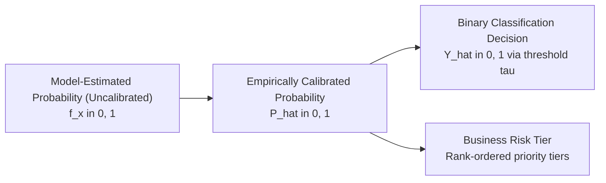

# Problem Definition: Retrospective Customer Churn Classification and Risk Ranking

## 1. Executive Summary & Formulation Scope

PredictLab is an experimental predictive analytics platform. For its initial machine learning task, the project utilizes the canonical IBM Telco Customer Churn sample dataset.

Because the underlying data is a single static, cross-sectional table lacking observation timestamps, event logs, or longitudinal customer histories, the initial machine learning task is formally defined as:

> **Retrospective customer churn classification and risk ranking using the available customer snapshot.**

This formulation establishes a clear methodological boundary: the system models statistical patterns that distinguish accounts that churned from accounts that remained active within a historical observation snapshot. It does **not** claim to provide an operational, production-ready future forecasting system, which would require time-stamped longitudinal records.

---

## 2. Business Context & Analytical Utility

1. **Retrospective Risk Attribution**: By analyzing the characteristics associated with customer attrition in the historical snapshot, organizations can diagnose structural churn drivers (e.g., month-to-month contracts, specific service bundle configurations, payment method friction).
2. **Account Risk Ranking**: Supervised classification models produce continuous score rankings that enable stakeholders to prioritize accounts by relative churn propensity rather than treating all customers uniformly.
3. **Platform Foundation**: Developing this retrospective pipeline establishes the modular architecture, validation tooling, evaluation protocols, and explainability mechanisms required for future deployments on longitudinal, time-stamped datasets.

---

## 3. Retrospective Classification vs. Genuine Future Forecasting

A rigorous distinction must be maintained between the current retrospective task and prospective future forecasting:

| Dimension | Retrospective Snapshot Classification (Current) | Prospective Future Forecasting (Production Ideal) |
|---|---|---|
| **Data Structure** | Static cross-sectional table (single row per customer account). | Longitudinal event logs or periodic panel snapshots ($T_0, T_1, \dots$). |
| **Prediction Timestamp ($T_0$)** | **Absent / Unverified**. No exact calendar date or billing cutoff is recorded. | **Explicitly Defined**. State features are measured strictly at or before $T_0$. |
| **Prediction Horizon ($\Delta t$)** | **Undefined**. Outcomes reflect historical status without an explicit future window. | **Strictly Validated** (e.g., probability of churn within 30, 60, or 90 days after $T_0$). |
| **Temporal Ordering** | Features and outcome are observed simultaneously in the snapshot. | Strictly causal: features precede the outcome observation window. |
| **Operational Applicability** | Exploratory diagnostic modeling and relative risk ranking. | Real-time / batch operational scoring for prospective retention campaigns. |

> [!WARNING]
> Because the dataset contains no timestamps or historical snapshot sequences, out-of-time (OOT) validation cannot be performed on this dataset. Offline performance metrics reflect cross-sectional discriminatory power, not validated temporal generalization across future calendar periods.

---

## 4. Formal Problem Specification

- **Unit of Analysis**: Individual customer subscription account (identified by `customerID`).
- **Input Features**: Vector $\mathbf{x}_i \in \mathbb{R}^d$ of 19 demographic, service, and billing attributes available in the cross-sectional record.
- **Target Variable**: `Churn` (documented in IBM metadata as denoting customers who discontinued service within the preceding month).
  - **Negative Class ($Y = 0$)**: `"No"` (retained customer accounts, $N = 5,174$, 73.46%).
  - **Positive Class ($Y = 1$)**: `"Yes"` (churned customer accounts, $N = 1,869$, 26.54%).

---

## 5. Model Output Terminology & Governance

To maintain scientific precision, PredictLab strictly distinguishes four levels of model output:

1. **Model-Estimated Class Probability (Uncalibrated) ($\hat{s}_i \in [0, 1]$)**:
   - Model-estimated class probabilities that have not yet undergone empirical calibration assessment (e.g., tree ensemble leaf fractions, logistic sigmoid outputs).
   - Raw scores frequently suffer from systematic distortion (e.g., over-confidence in boosted trees or compression in support vector machines).
2. **Empirically Calibrated Probability ($\hat{p}_i = P(Y_i = 1 \mid \hat{s}_i)$)**:
   - A probability score whose empirical reliability has been demonstrated and verified on held-out validation data (such that of accounts assigned $\hat{p} \approx 0.70$, approximately 70% actually churned).
   - **Phase 1 Status**: **No model has yet been trained or calibrated**. Model outputs will not be designated as "calibrated" until empirical calibration methods (e.g., Platt scaling, isotonic regression) and diagnostic tools (Brier score, Expected Calibration Error, reliability curves) are evaluated in Phase 5.
3. **Binary Classification Decision ($\hat{Y}_i \in \{0, 1\}$)**:
   - Discretized decision obtained by applying an explicit decision threshold $\tau \in (0, 1)$ to model probabilities.
   - Threshold selection is deferred to Phase 5 and will be optimized against asymmetric business misclassification costs rather than arbitrarily defaulting to $\tau = 0.5$.
4. **Business Risk Tiers**:
   - Categorical risk groupings (e.g., Low, Medium, High, Critical) designed to segment customers for targeted operational treatment.
   - **Phase 1 Status**: Risk-tier threshold boundaries are **explicitly deferred**. No speculative cutoffs will be invented until empirical score distributions and a concrete business cost-benefit utility policy are established in Phase 5.

---

## 6. Intended Stakeholders & Use Cases

- **Retention & Customer Success Analysts**: To inspect historical subscriber segments exhibiting elevated churn frequency and identify service configuration vulnerabilities.
- **Data Science Practitioners**: To benchmark classification algorithms, compare probabilistic calibration techniques, and audit feature attributions on a standardized dataset.
- **Platform Architecture Evaluation**: To demonstrate an end-to-end, reproducible ML pipeline that enforces strict separation between data ingestion, validation, modeling, and user presentation.

---

## 7. Methodological Limitations & Assumptions

1. **Absence of Historical Sequences**: The dataset reflects a single snapshot. Changes in customer behavior over time (e.g., usage drops, escalating support calls) cannot be captured.
2. **Correlation vs. Causation**: Statistical associations identified by classifiers do not imply causal relationships. Interventions (e.g., forcing a 2-year contract) cannot assume the churn reduction suggested by observational correlation.
3. **Stationarity Assumption**: Applying a snapshot-trained model to future operational data assumes that subscriber behavior, market competitors, and pricing structures remain stationary.
4. **Survivorship Bias**: Customers with longer `tenure` represent accounts that have remained active across early tenure cohorts where observed churn prevalence is highest. Without longitudinal tracking or event timestamps, this survivorship dynamic cannot be analyzed via survival or hazard modeling, and cannot be disentangled from genuine retention loyalty.
