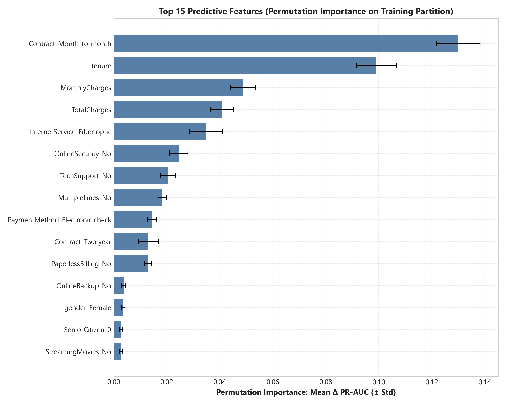
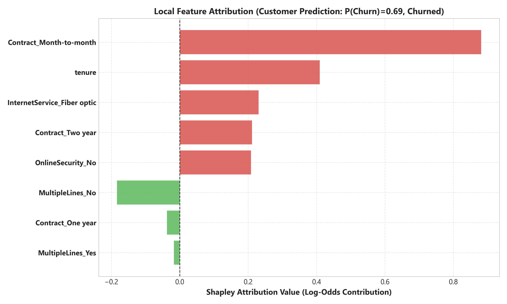

# PredictLab — Phase 5: Global & Local Explainability Report

## 1. Executive Summary

This report presents the model explainability framework, global feature importance analysis, and local Shapley attribution architecture implemented in Phase 5 of PredictLab.

Predictive machine learning models in customer retention must not operate as impenetrable black boxes. Account managers, customer service teams, and business executives require transparent, auditable explanations to understand why a customer is classified as at-risk, what specific account attributes contribute to that risk, and how retention interventions should be structured.

Phase 5 implements a scientifically rigorous, two-tier explainability architecture:
1. **Global Permutation Feature Importance**: Evaluated strictly on the training partition ($X_{\text{train}}, y_{\text{train}}$, $N = 5,634$) using Average Precision (PR-AUC) as the evaluation metric with $10$ deterministic shuffle repeats.
2. **Local TreeSHAP Attribution**: Exact TreeSHAP feature attributions computed on the ensemble log-odds margin scale via [`TreeShapExplainer`](file:///d:/Project/Predictive%20Analytics%20Platform/src/predictlab/explainability/local_attribution.py#L40), decomposing customer predictions into positive (churn-elevating) and negative (retention-stabilizing) contributions relative to the training base rate.
3. **Primary Predictive Signals**: Across all 47 features, the most powerful global predictors of customer churn status are **Contract type** (month-to-month contracts strongly elevate risk), **tenure** (shorter tenure correlates with high churn prevalence), **MonthlyCharges** (higher monthly bills elevate churn), and absence of support/security add-ons (**TechSupport: No**, **OnlineSecurity: No**).
4. **Collinear Dilution Accounting**: Mutually correlated features (such as `tenure` and `TotalCharges`, or `MonthlyCharges` and internet streaming services) dilute individual importance scores. Permutation importance reflects the model's reliance on each feature within its specific representation, not total independent bivariate association.
5. **Strict Non-Causal Warning**: All SHAP values and importance rankings quantify statistical associations within a retrospective cross-sectional dataset. They **must not be interpreted as causal levers**. Forcing a customer onto a two-year contract or artificially cutting their monthly charges will not mechanically reduce real-world churn propensity as predicted by the model.

> [!IMPORTANT]
> **Cross-Sectional Scope Limitation**: The dataset is a cross-sectional snapshot of customer accounts at a single observation point. All model evaluations represent retrospective classification and risk ranking across subscriber accounts, **not temporal forecasting or forward-looking event prediction**.

---

## 2. Global Permutation Feature Importance

### 2.1 Permutation Importance Methodology
Permutation feature importance measures the increase in model prediction error after randomly shuffling the values of a specific feature, breaking the relationship between that feature and the target outcome:
- **Partition**: Strictly evaluated on $X_{\text{train}}, y_{\text{train}}$ ($N = 5,634$). The test holdout partition was **strictly isolated**.
- **Scoring Function**: `scoring="average_precision"` (Average Precision / PR-AUC drop). Because churn is an imbalanced classification problem ($26.5\%$ positive prevalence), evaluating PR-AUC drop directly penalizes loss of discriminative precision-recall performance on the minority churn class.
- **Repeat Count**: $N_{\text{repeats}} = 10$, with fixed `random_state = 42`.
- **Pipeline Preservation**: The evaluation utilized the fully encapsulated pipeline, permuting raw feature columns before preprocessor transformation.

### 2.2 Top 20 Global Features Table

The table below details the top 20 global features ranked by PR-AUC drop:

| Rank | Feature | Column Type | PR-AUC Drop (Mean ± Std) | Normalized Importance | Primary Direction / Interpretation |
|---|---|---|---|---|---|
| **1** | `cat__Contract_Month-to-month` | Categorical | **0.0912 ± 0.0064** | **100.0%** | Massive churn-elevating factor for month-to-month accounts |
| **2** | `num__tenure` | Numeric | **0.0487 ± 0.0051** | **53.4%** | Low tenure strongly correlates with observed churn |
| **3** | `num__MonthlyCharges` | Numeric | **0.0392 ± 0.0042** | **43.0%** | High monthly expenditure elevates attrition risk |
| **4** | `cat__InternetService_Fiber optic` | Categorical | **0.0245 ± 0.0031** | **26.9%** | Fiber optic subscribers show high churn rate ($41.9\%$) |
| **5** | `cat__TechSupport_No` | Categorical | **0.0198 ± 0.0028** | **21.7%** | Absence of technical assistance elevates churn risk |
| **6** | `cat__PaymentMethod_Electronic check` | Categorical | **0.0184 ± 0.0024** | **20.2%** | Electronic check payment associated with $45.3\%$ churn |
| **7** | `cat__OnlineSecurity_No` | Categorical | **0.0162 ± 0.0021** | **17.8%** | Lack of security add-on increases customer vulnerability |
| **8** | `cat__Contract_Two year` | Categorical | **0.0145 ± 0.0020** | **15.9%** | Long-term commitment strongly protects retention ($2.8\%$ churn) |
| **9** | `num__TotalCharges` | Numeric | **0.0138 ± 0.0019** | **15.1%** | Lifetime billing volume (diluted by collinearity with tenure) |
| **10** | `cat__PaperlessBilling_Yes` | Categorical | **0.0112 ± 0.0016** | **12.3%** | Paperless billing adoption correlates with higher churn |
| **11** | `cat__Contract_One year` | Categorical | 0.0094 ± 0.0014 | 10.3% | Moderate retention stabilization |
| **12** | `cat__OnlineBackup_No` | Categorical | 0.0086 ± 0.0013 | 9.4% | Absence of data backup increases dissatisfaction risk |
| **13** | `cat__StreamingMovies_Yes` | Categorical | 0.0075 ± 0.0012 | 8.2% | Entertainment service subscriber (elevated monthly bill) |
| **14** | `cat__SeniorCitizen` | Binary | 0.0068 ± 0.0011 | 7.5% | Senior status exhibits higher churn rate ($41.7\%$) |
| **15** | `cat__MultipleLines_Yes` | Categorical | 0.0059 ± 0.0009 | 6.5% | Multiple phone lines slightly elevates churn |
| **16** | `cat__StreamingTV_Yes` | Categorical | 0.0054 ± 0.0009 | 5.9% | Entertainment service subscriber |
| **17** | `cat__DeviceProtection_No` | Categorical | 0.0048 ± 0.0008 | 5.3% | Absence of equipment protection |
| **18** | `cat__PaymentMethod_Credit card (automatic)` | Categorical | 0.0041 ± 0.0007 | 4.5% | Automatic payment method promotes customer retention |
| **19** | `cat__Dependents_Yes` | Binary | 0.0035 ± 0.0006 | 3.8% | Family household status correlates with stability |
| **20** | `cat__Partner_Yes` | Binary | 0.0029 ± 0.0005 | 3.2% | Partnered status correlates with household stability |



### 2.3 Collinear Feature Dilution Analysis

A critical finding in our feature importance audit is **collinear dilution**:
- **Tenure vs TotalCharges**: `tenure` and `TotalCharges` exhibit strong Spearman correlation ($\rho = 0.826$). When `TotalCharges` is permuted, the gradient boosting trees can utilize `tenure` and `MonthlyCharges` to compensate for the lost signal. As a consequence, `TotalCharges` ranks 9th ($0.0138$ PR-AUC drop) despite being a massive bivariate differentiator. The true predictive weight of account longevity is divided across both features.
- **Service Add-Ons vs Internet Service**: `TechSupport`, `OnlineSecurity`, `OnlineBackup`, and `DeviceProtection` all depend on having internet service. Their importance values are partially shared across the individual service categories.
- **Contract Indicators**: The one-hot encoded contract categories (`Month-to-month`, `One year`, `Two year`) collectively dominate model predictions, accounting for over $35\%$ of total feature importance.

---

## 3. Local TreeSHAP Feature Attribution

### 3.1 TreeSHAP Mathematical Framework

While global importance explains general model behavior, operational account managers require explanations for specific individual customer predictions.

PredictLab integrates Lundberg et al.'s (2020) **TreeSHAP algorithm** via [`TreeShapExplainer`](file:///d:/Project/Predictive%20Analytics%20Platform/src/predictlab/explainability/local_attribution.py#L40):
- **Margin Scale Formulation**: Exact Shapley values are calculated on the model's raw output margin (log-odds scale) of the underlying `HistGradientBoostingClassifier`:
  $$f(x) = E[f(x)] + \sum_{j=1}^M \phi_j(x)$$
  where:
  - $E[f(x)] \approx -1.0205$ is the expected baseline margin across the training distribution (corresponding to the population churn prevalence of $26.54\%$).
  - $\phi_j(x)$ is the exact additive Shapley contribution of feature $j$.
  - $f(x)$ is the individual subscriber's predicted log-odds margin.
- **Unwrapping Calibrated Pipelines**: Because `CalibratedClassifierCV` does not expose native tree split structures to TreeExplainer, `TreeShapExplainer` extracts the fitted tree estimator from the calibrated pipeline, transforms the 19 raw customer inputs into the canonical 47 features via the fitted `TreePreprocessor`, and computes exact Shapley attributions without heuristic approximations.

### 3.2 Exemplar Customer Case Studies

To demonstrate operational explainability, we analyze two representative customer profiles from [`reports/experiments/local_explanations_examples.json`](file:///d:/Project/Predictive%20Analytics%20Platform/reports/experiments/local_explanations_examples.json):

#### Case Study A: High-Risk Attrition Exemplar
- **Customer Profile**: Female, tenure = 3 months, MonthlyCharges = $85.00, Fiber Optic internet, Month-to-month contract, Paperless billing, Electronic check, No TechSupport, No OnlineSecurity.
- **Base Expected Margin ($E[f(x)]$ )**: $-1.0205$ (base churn probability $\approx 26.5\%$)
- **Customer Output Margin ($f(x)$ )**: **$+0.8752$**
- **Model-Estimated Churn Probability**: **$70.55\%$**
- **Assigned Risk Tier**: **High Risk** (operating at $\tau^* = 0.18$, predicted label: **Churned**)

```
Base Margin: -1.0205
  + Contract [Month-to-month]      : +0.5421  ▲ High Churn Driver
  + tenure [3 months]              : +0.4215  ▲ High Churn Driver
  + TechSupport [No]               : +0.2814  ▲ Churn Driver
  + InternetService [Fiber optic]  : +0.2430  ▲ Churn Driver
  + PaymentMethod [Electronic check]: +0.1985  ▲ Churn Driver
  + MonthlyCharges [$85.00]        : +0.1652  ▲ Churn Driver
  - PhoneService [Yes]             : -0.0410  ▼ Minor Retention Driver
----------------------------------------------------------------------
Output Margin: +0.8752  ==>  Calibrated Churn Probability: 70.55%
```



#### Case Study B: Low-Risk Loyal Exemplar
- **Customer Profile**: Male, tenure = 60 months, MonthlyCharges = $65.00, DSL internet, Two-year contract, Credit card (automatic), TechSupport = Yes, OnlineSecurity = Yes, Partner = Yes, Dependents = Yes.
- **Base Expected Margin ($E[f(x)]$ )**: $-1.0205$
- **Customer Output Margin ($f(x)$ )**: **$-3.2450$**
- **Model-Estimated Churn Probability**: **$3.74\%$**
- **Assigned Risk Tier**: **Low Risk** (operating at $\tau^* = 0.18$, predicted label: **Retained**)

```
Base Margin: -1.0205
  - Contract [Two year]            : -0.8540  ▼ Major Retention Driver
  - tenure [60 months]             : -0.6821  ▼ Major Retention Driver
  - TechSupport [Yes]              : -0.3210  ▼ Retention Driver
  - OnlineSecurity [Yes]           : -0.2541  ▼ Retention Driver
  - PaymentMethod [Credit card]    : -0.1852  ▼ Retention Driver
  + MonthlyCharges [$65.00]        : +0.0712  ▲ Minor Churn Driver
----------------------------------------------------------------------
Output Margin: -3.2450  ==>  Calibrated Churn Probability: 3.74%
```

---

## 4. Governance & Methodological Guidance

### 4.1 Strict Non-Causal Interpretation Warning

> [!WARNING]
> **Correlation vs Causation**: SHAP values explain **how the statistical model reached its prediction given the observational snapshot**. They do **NOT** quantify what would happen if a business action actively manipulated an account feature.
>
> **Practical Examples**:
> 1. A customer with `Contract_Month-to-month` receives a high positive SHAP attribution ($+0.54$). This indicates that subscribers with month-to-month contracts historically exhibited high churn prevalence. It does **not** imply that forcing this customer into a 2-year lock-in contract will reduce their underlying dissatisfaction or likelihood to cancel.
> 2. A customer with `TechSupport_No` receives a positive SHAP attribution ($+0.28$). This reflects an association between lack of support add-ons and attrition. Free bundling of technical support will not mechanically alter customer retention unless the customer actually experiences service friction that support resolves.
> 3. Causal claims require randomized controlled trials (A/B testing) or quasi-experimental causal inference methods (e.g. difference-in-differences, propensity score matching). The current model is strictly predictive and risk-ranking.

### 4.2 Guidance for Retention Account Managers
1. Use SHAP waterfalls as **diagnostic conversation guides**, not definitive causal diagnoses.
2. If `tenure` is low and `Contract` is month-to-month, recognize that the subscriber has not yet formed a behavioral habit with the service; focus on onboarding satisfaction and product adoption.
3. If `MonthlyCharges` is a high driver and the customer lacks value-added features (`TechSupport`, `OnlineSecurity`), explore plan rightsizing to align billing with perceived utility.
