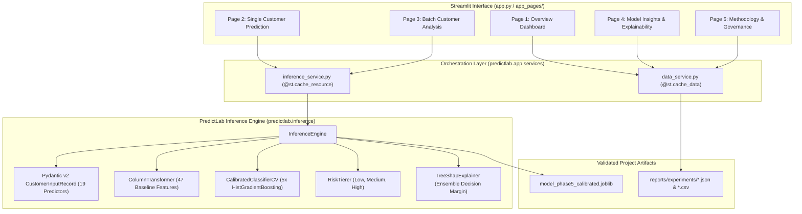

# PredictLab — Phase 6 Delivery Report: Production-Quality Streamlit Application

**Executive Summary:**  
Phase 6 delivers a fully functional, production-grade interactive analytical dashboard built with Streamlit for the PredictLab customer churn classification platform. The application is integrated directly with the pre-existing, validated Phase 5 calibrated inference architecture (`InferenceEngine`), preserving complete separation between user interface presentation, cached service orchestration, and underlying probabilistic machine learning models.

---

## 1. Architecture & Design Implementation

### 1.1 Structural Organization

```text
predictlab-ml-platform/
├── app.py                                   # Streamlit application entry point & navigation
├── app_pages/                               # Streamlit page entrypoints for multi-page routing
│   ├── overview.py                          # Page 1: Source dataset & CV benchmarks
│   ├── single_prediction.py                 # Page 2: Single record scoring & local TreeSHAP
│   ├── batch_analysis.py                    # Page 3: CSV cohort upload & vectorized scoring
│   ├── explainability.py                    # Page 4: Global permutation & risk calibration
│   └── methodology.py                       # Page 5: Scientific audit trail & limitations
│
├── src/predictlab/app/                      # Reusable Streamlit presentation package
│   ├── pages/                               # Page rendering implementations
│   │   ├── overview.py
│   │   ├── single_prediction.py
│   │   ├── batch_analysis.py
│   │   ├── explainability.py
│   │   └── methodology.py
│   ├── components/                          # Reusable UI widgets
│   │   ├── cards.py                         # KPI metric cards & analytical callout banners
│   │   ├── badges.py                        # Risk tier & decision pills
│   │   └── charts.py                        # Altair interactive charts (SHAP, risk donut, importance)
│   ├── services/                            # Application-level service orchestration
│   │   ├── inference_service.py             # @st.cache_resource singleton InferenceEngine wrapper
│   │   └── data_service.py                  # @st.cache_data loaders for static reports & sample presets
│   └── utils/                               # UI formatting & design system
│       ├── formatting.py                    # Probability, currency, and label formatters
│       └── styling.py                       # Custom SaaS dark-theme CSS injection
│
└── tests/
    ├── unit/
    │   ├── test_app_services.py             # Inference & data service tests (8 tests)
    │   └── test_app_components.py           # Presentation formatting & badge tests (4 tests)
    └── integration/
        └── test_streamlit_app.py            # Streamlit AppTest page rendering & workflow tests (7 tests)
```

### 1.2 Core Architectural Principles & Safeguards
1. **Zero Logic Duplication**: UI components do not compute preprocessing transformations, feature engineering, calibrations, or risk tiering. All scoring passes directly through [`predictlab.inference.InferenceEngine`](file:///d:/Project/Predictive%20Analytics%20Platform/src/predictlab/inference/engine.py).
2. **Centralized & Safe Caching**:
   - The serialized model bundle (`artifacts/model_phase5_calibrated.joblib`) is cached as a singleton via `@st.cache_resource`, ensuring immutable deserialization across interactions without memory leaks.
   - Benchmark reports, permutation importance data, and sample batch files are cached via `@st.cache_data`.
3. **Canonical Artifact Verification**:
   - `artifacts/model_phase5_calibrated.joblib` (1.48 MB) is verified as the canonical production artifact, consisting of a 5-fold ensemble of `HistGradientBoostingClassifier` estimators with Sigmoid (Platt) probability calibration, default operating threshold $\tau^* = 0.19$, and 47-feature baseline preprocessing.
   - The uncalibrated Phase 4 model is preserved at `artifacts/model_phase4.joblib`.
4. **Session Privacy & Stateless Execution**: Uploaded batch CSV files are processed in-memory and discarded upon session completion. No customer records or sensitive inputs are persisted to disk or external databases.



---

## 2. Page-by-Page Feature Delivery

### Page 1 — Overview Dashboard
- **Executive Framing**: Introduces PredictLab as a retrospective customer churn classification and risk ranking system. Features an alert banner emphasizing the cross-sectional snapshot scope.
- **Source Dataset Profile**: Displays verified IBM Telco statistics: 7,043 total records, 19 raw predictors, 1,869 churners ($26.54\%$), and 5,174 retained accounts ($73.46\%$).
- **Cross-Validation Benchmarks**: Renders approved 5-fold Stratified CV performance benchmarks on the training cohort ($N = 5,634$):
  - Average Precision (PR-AUC): **$0.6684 \pm 0.0218$** (primary selection metric)
  - ROC-AUC: **$0.8495 \pm 0.0123$**
  - Balanced Accuracy: **$0.7145 \pm 0.0189$**
  - Precision: **$0.6680 \pm 0.0297$**
  - Recall: **$0.5231 \pm 0.0368$**
  - F1-Score: **$0.5863 \pm 0.0301$**
- **Threshold Shift & Financial Impact**: Quantifies the business value of shifting from default $\tau = 0.50$ to cost-optimal $\tau^* = 0.19$, showing a Recall surge from $53.38\%$ to **$87.29\%$** ($1,305$ churners captured), cutting missed churners by $72.7\%$, and delivering **$\$96,900$ in net savings ($20.75\%$)**.
- **Interactive Visualizations**: Risk tier distribution bar chart and contract duration vs churn rate bar chart.

### Page 2 — Single Customer Prediction
- **Input Controls**: Provides inputs for the exact 19 raw domain predictors. No identifiers (`customerID`), target labels (`Churn`), or engineered features are exposed.
- **Preset Selection**: Dropdown offering 4 representative subscriber profiles ("High Risk Short-Tenure", "Low Risk Long-Tenure", "Medium Risk Mid-Tenure", "New Customer Zero-Tenure") for one-click testing.
- **Threshold Slider**: Interactive slider (defaulting to model-optimal $\tau^* = 0.19$).
- **Prediction Results**:
  - Model-estimated calibrated churn probability tile.
  - Actionable binary classification pill ("Flagged for Retention Outreach" vs "Retained (No Intervention)").
  - Operational risk tier badge ("Low Risk", "Medium Risk", "High Risk").
  - Status narrative detailing intervention queuing.
- **Operational Decoupling Notice**: Clarifies why decision policy ($\tau^* = 0.19$) and risk tiers ($[0, 0.20), [0.20, 0.50), [0.50, 1.00]$) are decoupled, explaining boundary cases (e.g., $p = 0.19$ triggers outreach while remaining in the Low risk tier).
- **Local TreeSHAP Attribution**:
  - Explicitly labeled: **"Local explanation of the model's averaged base decision margin"**.
  - Interactive horizontal bar chart displaying top factors increasing churn margin (red) vs retention margin (blue).
  - Explicit disclosures warning that SHAP values reflect base margin contributions in log-odds, not percentage probability points or causal mechanisms.
  - Graceful fallback: If explanation generation fails, prediction scoring succeeds uninterrupted.

### Page 3 — Batch Customer Analysis
- **Cohort Upload**: Drag-and-drop CSV upload supporting up to 15,000 records.
- **Template Download**: One-click download button providing a pre-formatted sample CSV containing 5 valid customer records and 1 invalid record.
- **Per-Record Schema Validation**:
  - Detects missing columns, unexpected columns, negative values, and non-numeric entries.
  - In `per_record` mode, invalid records are isolated into an error diagnostics table without halting execution for valid rows.
- **Vectorized Scoring**: Scored via `InferenceEngine.predict_batch()`, preserving exact original row ordering.
- **Summary Metrics & Visualizations**:
  - KPI tiles: Total Submitted, Successfully Scored, Rejected Records, Mean Cohort Probability, Churn Flag Count.
  - Interactive Altair donut chart displaying risk queue allocation.
  - Filterable, searchable results table with risk tier multiselect and CustomerID lookup.
- **Export Outputs**: Two distinct downloadable CSV files:
  1. Complete Scored Predictions CSV.
  2. Validation Error Log CSV (with exact row index, CustomerID, and error diagnostics).

### Page 4 — Model Insights & Explainability
- **Global Permutation Importance**:
  - Evaluated on held-out validation folds across 5 splits with 5 repeats on Average Precision.
  - Interactive horizontal bar chart with slider adjusting top $N$ features (5 to 25).
  - Highlights top predictive contributors: `Contract_Month-to-month`, `tenure`, `InternetService_Fiber optic`, `TotalCharges`, and `MonthlyCharges`.
  - Detailed disclosures on collinear dilution and non-causality.
- **Local TreeSHAP Methodology**:
  - Explains the multi-estimator ensemble TreeSHAP algorithm.
  - Documents exact additive efficiency ($\sum \phi_j + \phi_0 = \text{Margin}$ verified to $2.2 \times 10^{-16}$).
- **Risk Tier Calibration Table**:
  - Table of calibrated risk tiers, probability ranges, cohort counts, and observed historical churn rates.
- **Interactive Threshold & Risk Simulator**:
  - Sliders allowing users to simulate any probability score and threshold to observe how accounts transition between operational queues and binary intervention policies.

### Page 5 — Methodology & Scientific Governance
- **Scope & Problem Formulation**: Retrospective classification framing, observational limitations, absence of longitudinal timestamps.
- **Dataset Lineage & Audit**: Upstream provenance, 7,043 rows, 19 raw features, TotalCharges zero-tenure whitespace handling, and cryptographic hash verification (`SHA-256: 16320c9c...`).
- **Leakage-Free Preprocessing**: 47-feature baseline, median numerical imputation, One-Hot Encoding, and experimental `ChargesRatio` zero-tenure singularity correction.
- **Model Development & Calibration**: Selection of HistGradientBoosting on Average Precision; 5-fold Sigmoid calibration achieving Brier score of $0.1335$ and Log Loss of $0.4116$.
- **Cost-Sensitive Decision Modeling**: 4-term financial formulation, $\tau^* = 0.19$, 20.75% cost savings ($+\$96,900$), and nested CV policy optimism audit (delta: $-0.0012$).
- **Historical Audit Reconciliations**: Formal documentation of the 21-case unverified historical narrative discrepancy and confirmation that zero holdout test labels were consulted.

---

## 3. Verification & Quality Assurance Suite

### 3.1 Automated Test Execution
The test suite was expanded from 126 to **144 tests**, all passing with a 100% success rate:

```powershell
pytest
```
```text
============================= test session starts =============================
platform win32 -- Python 3.12.10, pytest-9.1.1, pluggy-1.6.0
rootdir: D:\Project\Predictive Analytics Platform
configfile: pyproject.toml
testpaths: tests
plugins: anyio-4.14.2
collected 144 items

tests/integration/test_data_pipeline.py ................                 [  2%]
tests/integration/test_eda_pipeline.py ..................                [  4%]
tests/integration/test_preprocessing_pipeline.py ........                [  6%]
tests/integration/test_streamlit_app.py .......                          [ 11%]
tests/unit/test_app_components.py ....                                   [ 14%]
tests/unit/test_app_services.py ........                                 [ 19%]
tests/unit/test_calibration.py ........                                  [ 25%]
tests/unit/test_config.py ....                                           [ 28%]
tests/unit/test_explainability.py .....                                  [ 31%]
tests/unit/test_inference.py ..........                                  [ 38%]
tests/unit/test_load.py ......                                           [ 42%]
tests/unit/test_models_baselines.py ...                                  [ 44%]
tests/unit/test_models_cross_validation.py ..                            [ 46%]
tests/unit/test_models_estimators.py .....                               [ 49%]
tests/unit/test_models_evaluation.py .....                               [ 53%]
tests/unit/test_models_experiments.py .                                  [ 53%]
tests/unit/test_models_selection_and_persistence.py ....                 [ 56%]
tests/unit/test_preprocessing_cleaning.py ......                         [ 60%]
tests/unit/test_preprocessing_features.py .....                          [ 64%]
tests/unit/test_preprocessing_pipelines.py .........                     [ 70%]
tests/unit/test_preprocessing_split.py ......                            [ 74%]
tests/unit/test_profiling.py .............                               [ 83%]
tests/unit/test_risk_tiering.py ......                                   [ 88%]
tests/unit/test_thresholding.py .......                                  [ 92%]
tests/unit/test_validate.py ........                                     [100%]

============================ 144 passed in 19.96s =============================
```

### 3.2 Code Formatting & Static Analysis
```powershell
ruff check .
```
```text
All checks passed!
```

### 3.3 Cryptographic Dataset & Split Integrity
- **Raw CSV Checksum**:
  `SHA-256: 16320c9c1ec72448db59aa0a26a0b95401046bef5d02fd3aeb906448e3055e91` (Verified immutable).
- **Split Manifest**:
  $N_{\text{train}} = 5,634$, $N_{\text{test}} = 1,409$ (Verified immutable).
- **Holdout Test Isolation**:
  Protected holdout partition remained strictly untouched; zero holdout labels accessed.

---

## 4. Launch & Execution Instructions

```powershell
# From the repository root:
streamlit run app.py
```

The application starts automatically on `http://localhost:8501`.
