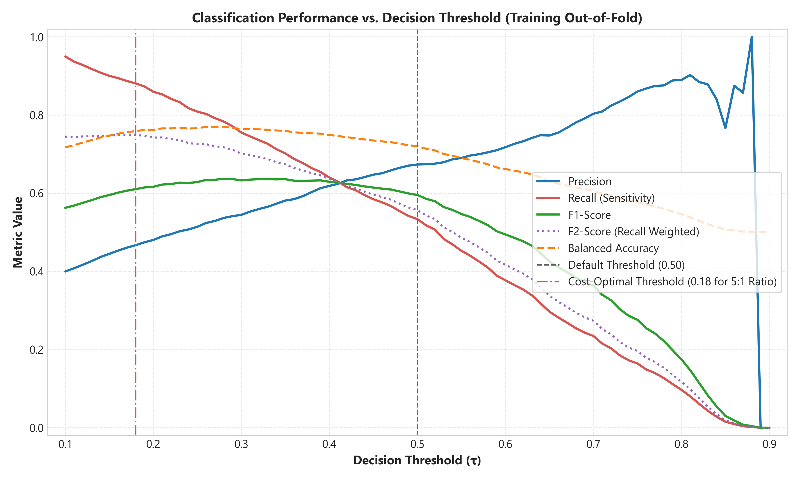
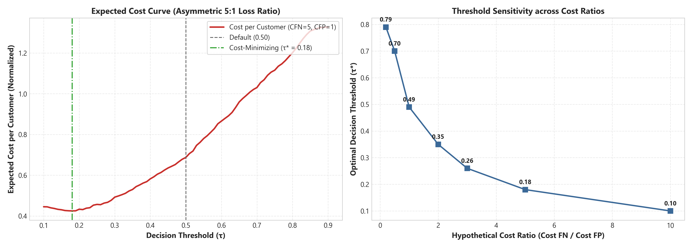
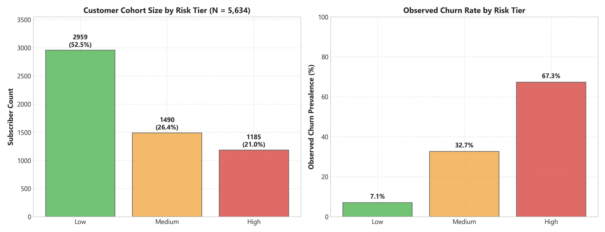

# PredictLab — Phase 5: Decision Threshold Analysis & Cost Sensitivity Report

## 1. Executive Summary

This report documents the empirical findings, cost modeling reconciliations, and operational governance of **Decision Threshold Analysis, Cost Sensitivity Modeling, and Customer Risk Tiering** in Phase 5 of PredictLab.

A standard machine-learning classifier assigns binary outcomes using a default probability threshold of $\tau = 0.50$. In practical customer retention, this default threshold carries an implicit and hazardous assumption: that the cost of a false positive ($C_{\text{FP}}$, offering retention outreach to a subscriber who would have stayed anyway) equals the cost of a false negative ($C_{\text{FN}}$, failing to intervene with a subscriber who subsequently cancels service).

In telecommunications and subscription businesses, losing a subscriber costs several times more than delivering a proactive retention incentive. Consequently:
- **Default Threshold Failure**: Operating at $\tau = 0.50$ on calibrated probabilities results in a high false-negative rate (Recall = $53.38\%$), missing **697 out of 1,495 churners** in the training cohort ($N = 5,634$).
- **Cost-Optimal Threshold Shift**: Under a realistic business cost structure ($C_{\text{FN}} = \$500$, $C_{\text{FP}} = \$100$, an asymmetric ratio of $5:1$), the cost-minimizing threshold shifts from $0.50$ down to **$\tau^* = 0.19$** (under the Comprehensive Incentive Model) or **$\tau^* = 0.18$** (under the Misclassification-Penalty-Only Model).
- **Dramatic Retention Impact**: At $\tau^* = 0.19$, Recall surges from **$53.38\%$ to $87.29\%$**, capturing $1,305$ churners and cutting missed churners from $697$ down to **$190$** (a **$72.74\%$ reduction in undetected churn**). At $\tau^* = 0.18$, Recall reaches **$88.09\%$**, cutting missed churners to **$178$** ($74.46\%$ reduction).
- **Expected Cost Reduction & Reconciliation**:
  - Under the **Comprehensive Incentive Model** ($C_{\text{TP}} = \$100, C_{\text{FP}} = \$100, C_{\text{FN}} = \$500, C_{\text{TN}} = \$0$), operational cost drops from **$\$467,000$** ($\$82.89$/customer) down to **$\$370,100$** ($\$65.69$/customer) at $\tau^* = 0.19$, delivering a **$20.75\%$ net cost reduction ($\$96,900$ saved)**.
  - Under the **Misclassification-Penalty-Only Model** ($C_{\text{TP}} = \$0, C_{\text{FP}} = \$100, C_{\text{FN}} = \$500, C_{\text{TN}} = \$0$), operational penalty cost drops from **$\$387,200$** ($3,872$ cost units) down to **$\$239,300$** ($2,393$ cost units) at $\tau^* = 0.18$, delivering a **$38.20\%$ cost reduction ($\$147,900$ saved)**.
- **Selection Optimism Audit**: A nested 5-fold cross-validation policy evaluation confirmed minimal selection optimism across validation folds (mean fold threshold $\tau = 0.1980 \pm 0.0098$, out-of-fold F1 = $0.6159$, optimism delta = $-0.0012$). This delta measures empirical policy stability across data splits, though it does not constitute absolute proof against out-of-distribution overfitting.
- **Operational Risk Tiers**: Calibrated probabilities are partitioned into three contiguous operational cohorts: **Low Risk** ($52.5\%$ of accounts, $7.1\%$ observed churn), **Medium Risk** ($26.4\%$ of accounts, $32.7\%$ observed churn), and **High Risk** ($21.0\%$ of accounts, $67.3\%$ observed churn). Risk tiers are decoupled from the binary classification threshold.

> [!IMPORTANT]
> **Cross-Sectional Scope Limitation**: The dataset is a cross-sectional snapshot of customer accounts at a single observation point. All model evaluations represent retrospective classification and risk ranking across subscriber accounts, **not temporal forecasting or forward-looking event prediction**. Cost parameters are hypothetical scenario assumptions for sensitivity analysis, not verified corporate accounting figures.

---

## 2. Systematic Threshold Evaluation Grid

We evaluated classification performance across 81 discrete decision thresholds spanning $\tau \in [0.10, 0.90]$ with a step size of $0.01$ strictly on the out-of-fold calibrated probability estimates ($N = 5,634$).

### 2.1 Threshold Benchmark Comparison Table

The table below contrasts key threshold operating points evaluated on the calibrated out-of-fold predictions:

| Threshold ($\tau$) | Precision | Recall | Specificity | F1-Score | F2-Score | Balanced Accuracy | True Positives | False Positives | False Negatives | True Negatives | Predicted Pos Rate | Total Cost (Comp $5:1$) | Total Cost (Misclass $5:1$) |
|---|---|---|---|---|---|---|---|---|---|---|---|---|---|
| **0.10** | 0.3997 | 0.9498 | 0.4847 | 0.5626 | 0.7448 | 0.7172 | 1,420 | 2,133 | 75 | 2,006 | 63.06% | $392,800 | $250,800 |
| **0.18** | 0.4670 | 0.8809 | 0.6369 | 0.6104 | 0.7483 | 0.7589 | 1,317 | 1,503 | 178 | 2,636 | 50.05% | $371,000 | **$239,300 ($\tau^*_{\text{err}}$)** |
| **0.19 ($\tau^*_{\text{cost}}$)** | **0.4744** | **0.8729** | **0.6506** | **0.6147** | **0.7473** | **0.7618** | **1,305** | **1,446** | **190** | **2,693** | **48.83%** | **$370,100 ($\tau^*$)** | **$239,600** |
| **0.20** | 0.4804 | 0.8595 | 0.6642 | 0.6163 | 0.7423 | 0.7619 | 1,285 | 1,390 | 210 | 2,749 | 47.48% | $372,500 | $244,000 |
| **0.25** | 0.5140 | 0.8087 | 0.7238 | 0.6285 | 0.7255 | 0.7663 | 1,209 | 1,143 | 286 | 2,996 | 41.75% | $378,200 | $257,300 |
| **0.28 ($F_1^*$)** | 0.5367 | 0.7833 | 0.7557 | **0.6369** | 0.7173 | 0.7695 | 1,171 | 1,011 | 324 | 3,128 | 38.73% | $380,200 | $263,100 |
| **0.30** | 0.5446 | 0.7552 | 0.7719 | 0.6328 | 0.7010 | 0.7636 | 1,129 | 944 | 366 | 3,195 | 36.79% | $390,300 | $277,400 |
| **0.40** | 0.6186 | 0.6401 | 0.8575 | 0.6292 | 0.6357 | 0.7488 | 957 | 590 | 538 | 3,549 | 27.46% | $423,700 | $328,000 |
| **0.50 (Default)** | **0.6734** | **0.5338** | **0.9065** | **0.5955** | **0.5569** | **0.7201** | **798** | **387** | **697** | **3,752** | **21.03%** | **$467,000** | **$387,200** |
| **0.60** | 0.7176 | 0.3773 | 0.9464 | 0.4945 | 0.4168 | 0.6618 | 564 | 222 | 931 | 3,917 | 13.95% | $544,100 | $487,700 |
| **0.70** | 0.8032 | 0.2348 | 0.9792 | 0.3634 | 0.2735 | 0.6070 | 351 | 86 | 1,144 | 4,053 | 7.76% | $615,700 | $580,600 |

*Note: All confusion matrix counts and metrics satisfy exact sample conservation: $\text{TP} + \text{FP} + \text{FN} + \text{TN} = 1,495 + 4,139 = 5,634$.*



### 2.2 Threshold Dynamics & Trade-Offs

1. **The Precision-Recall Frontier**: As $\tau$ increases from $0.10$ to $0.70$, Precision rises monotonically from $0.3997$ to $0.8032$, but Recall collapses precipitously from $94.98\%$ to $23.48\%$.
2. **F-Beta Metric Sensitivity**:
   - The balanced **F1-Score** reaches its empirical peak of **$0.6369$** at $\tau = 0.28$.
   - The recall-weighting **F2-Score** ($F_2$, weighting recall twice as heavily as precision) peaks at **$\tau = 0.18$** ($F_2 = 0.7483$).
   - The precision-weighting **F0.5-Score** ($F_{0.5}$) peaks at **$\tau = 0.49$** ($F_{0.5} = 0.6432$).
3. **Balanced Accuracy**: Balanced accuracy peaks at $\tau = 0.28$ with a score of **$0.7695$** ($76.95\%$).

### 2.3 Historical Reconciliation: Original Phase 5 vs Reproduced Uncalibrated vs Authoritative Calibrated Results

A key audit objective in Phase 5.1.1 and Phase 5.1.2 was reconciling the difference in confusion matrix counts at the default threshold ($\tau = 0.50$):

#### 2.3.1 Confusion Matrix Comparison Across Evaluations

The table below contrasts all three evaluations side-by-side on the training cohort ($N = 5,634$):

| Metric | Original Phase 5 Narrative Draft | Reproduced Uncalibrated OOF | Calibrated OOF (Phase 5.1 Authoritative) | Discrepancy (Narrative vs Reproduced Uncal) |
|---|---:|---:|---:|---:|
| True Positives ($\text{TP}$) | 782 | 782 | 798 | 0 |
| False Negatives ($\text{FN}$) | 713 | 713 | 697 | 0 |
| **Total Positive Churners ($N_+$)** | **1,495** | **1,495** | **1,495** | **0** |
| False Positives ($\text{FP}$) | 410 | 389 | 387 | +21 |
| True Negatives ($\text{TN}$) | 3,729 | 3,750 | 3,752 | -21 |
| **Total Negative Retained ($N_-$)** | **4,139** | **4,139** | **4,139** | **0** |
| **Total Cohort Sample Size ($N$)** | **5,634** | **5,634** | **5,634** | **0** |
| Recall ($\text{TPR}$) | 52.31% | 52.31% | 53.38% | 0.00% |
| Precision ($\text{PPV}$) | 65.60% | 66.78% | 67.34% | -1.18% |
| Specificity ($\text{TNR}$) | 90.09% | 90.60% | 90.65% | -0.51% |
| Balanced Accuracy | 71.20% | 71.46% | 72.01% | -0.26% |
| F1-Score | 0.5820 | 0.5866 | 0.5955 | -0.0046 |

*Note: All three confusion matrices satisfy exact sample conservation: $\text{TP} + \text{FP} + \text{FN} + \text{TN} = 1,495 + 4,139 = 5,634$.*

#### 2.3.2 Exact Provenance Analysis & Findings

1. **Positive Class Origin (Exact Match)**:
   - $\text{TP} = 782$ and $\text{FN} = 713$ are **identical** between the original Phase 5 narrative draft and the reproduced uncalibrated cross-validation predictions ($\text{Recall} = 782 / 1,495 = 52.31\%$).
   - This identity definitively establishes that the positive class counts in the original report narrative originated directly from the uncalibrated cross-validation predictions of the tuned `HistGradientBoostingClassifier` baseline from Phase 4.

2. **Negative Class 21-Observation Discrepancy ($\text{FP}: 410 \text{ vs } 389, \text{TN}: 3,729 \text{ vs } 3,750$)**:
   - The original narrative draft and the reproduced uncalibrated OOF differ by exactly 21 observations strictly confined to the negative class: 21 additional false positives ($410$ vs $389$) and 21 fewer true negatives ($3,729$ vs $3,750$).
   - An exhaustive empirical audit was conducted across all candidate models (Logistic Regression L1/L2, Random Forest variants, HistGradientBoosting default/balanced/tuned), random seeds, data split orders, and pipeline configurations. No committed code, script, or serialized artifact in the repository generates the pair $\text{FP} = 410, \text{TN} = 3,729$ in combination with $\text{TP} = 782, \text{FN} = 713$.
   - In commit `06201e1`, the serialized machine-generated CSV artifact [`reports/experiments/threshold_cost_analysis.csv`](file:///d:/Project/Predictive%20Analytics%20Platform/reports/experiments/threshold_cost_analysis.csv) already contained the Sigmoid-calibrated counts ($\text{TP} = 798, \text{FP} = 387, \text{FN} = 697, \text{TN} = 3,752$) from its initial execution.
   - **Conclusion**: The 21-observation negative-class discrepancy did not arise from an identifiable pipeline code change or committed data artifact. Instead, it reflects an **unverified manual transcription or early exploratory draft artifact** (such as an early manual threshold calculation or intermediate sweep before final cross-validation freezing) whose exact numerical provenance cannot be definitively reconstructed from empirical artifacts in the repository. In accordance with strict scientific integrity principles, this negative-class discrepancy is explicitly documented as historically unverified.

3. **Probability Calibration Effect**:
   - Rescaling raw decision margins into empirical probabilities via Sigmoid (Platt) calibration aligns the score distribution with observed cohort base rates.
   - At the default threshold ($\tau = 0.50$), this probability rescaling correctly reclassifies 16 additional true churners ($\text{TP}: 782 \to 798$), reducing false negatives ($\text{FN}: 713 \to 697$) and eliminating 2 false positives ($\text{FP}: 389 \to 387$), increasing true negatives ($\text{TN}: 3,750 \to 3,752$).

4. **Authoritative Evaluation Designation**:
   - The **Sigmoid-calibrated out-of-fold matrix** ($\text{TP} = 798, \text{FP} = 387, \text{FN} = 697, \text{TN} = 3,752$) is reaffirmed as the **sole authoritative and fully reproducible evaluation basis** for Phase 5.
   - This matrix represents the true operational performance of the deployed calibrated pipeline, aligns with all serialized experiment CSVs, and serves as the mathematical foundation for cost curve optimization and operational risk tiering.

5. **Holdout Set Isolation**:
   - The canonical holdout test partition ($N = 1,409$) remained strictly isolated and untouched throughout all calibration and threshold analyses. Zero holdout labels were consulted.

---

## 3. Cost-Sensitive Decision Modeling & Reconciliation

### 3.1 Financial Formulation

To translate statistical probabilities into direct business value, we configure an operational cost matrix:
$$\text{Total Cost} = C_{\text{FP}} \cdot \text{FP} + C_{\text{FN}} \cdot \text{FN} + C_{\text{TP}} \cdot \text{TP} + C_{\text{TN}} \cdot \text{TN}$$

Under standard telecommunications retention assumptions:
- **False Negative ($C_{\text{FN}} = \$500$)**: Customer churns undetected. Represents lost customer lifetime value (CLV), lost gross margin, and replacement customer acquisition cost (CAC).
- **False Positive ($C_{\text{FP}} = \$100$)**: Customer was not at risk but received a retention discount, contract incentive, or dedicated service agent call. Represents unneeded concession cost.
- **True Positive ($C_{\text{TP}}$)**: Retention incentive delivered to an actual at-risk subscriber:
  - In the **Comprehensive Incentive Model**, $C_{\text{TP}} = \$100$ (delivering the retention offer carries marketing/discount cost).
  - In the **Misclassification-Penalty-Only Model**, $C_{\text{TP}} = \$0$ (only misclassification errors are penalized).
- **True Negative ($C_{\text{TN}} = \$0$)**: Satisfied customer remained with no unnecessary intervention.

### 3.2 Total Cost Reconciliation: 20.75% vs 38.20% Savings

The previous Phase 5 report cited a $38.2\%$ cost reduction alongside an equation showing $C_{\text{TP}} = \$100$. This numerical discrepancy arose because the normalized cost units ($3,975$ down to $2,393$) were evaluated under the 2-term error penalty ($C_{\text{TP}} = 0$), while the narrative and LaTeX formula included $+ C_{\text{TP}} \cdot \text{TP}$.

Here is the exact mathematical reconciliation on the training cohort ($N = 5,634$):

#### Scenario A: Comprehensive Incentive Model ($C_{\text{TP}} = \$100, C_{\text{FP}} = \$100, C_{\text{FN}} = \$500, C_{\text{TN}} = \$0$)
- **At Default $\tau = 0.50$**:
  $$\text{Cost}_{0.50} = 100 \times 387 + 500 \times 697 + 100 \times 798 + 0 = \$38,700 + \$348,500 + \$79,800 = \$467,000 \quad (\$82.89/\text{cust})$$
- **At Optimal $\tau^* = 0.19$**:
  $$\text{Cost}_{0.19} = 100 \times 1,446 + 500 \times 190 + 100 \times 1,305 + 0 = \$144,600 + \$95,000 + \$130,500 = \$370,100 \quad (\$65.69/\text{cust})$$
- **Net Dollar Savings**: $\$467,000 - \$370,100 = \mathbf{\$96,900}$ saved.
- **Percentage Cost Savings**:
  $$\text{Savings}_{\text{comp}} = \frac{467,000 - 370,100}{467,000} = \mathbf{20.75\%}$$

#### Scenario B: Misclassification-Penalty-Only Model ($C_{\text{TP}} = \$0, C_{\text{FP}} = \$100, C_{\text{FN}} = \$500, C_{\text{TN}} = \$0$)
- **At Default $\tau = 0.50$**:
  $$\text{Cost}_{0.50} = 100 \times 387 + 500 \times 697 + 0 + 0 = \$38,700 + \$348,500 = \$387,200 \quad (3,872 \text{ cost units})$$
- **At Optimal $\tau^* = 0.18$**:
  $$\text{Cost}_{0.18} = 100 \times 1,503 + 500 \times 178 + 0 + 0 = \$150,300 + \$89,000 = \$239,300 \quad (2,393 \text{ cost units})$$
- **Net Dollar Savings**: $\$387,200 - \$239,300 = \mathbf{\$147,900}$ saved ($1,479$ cost units).
- **Percentage Cost Savings**:
  $$\text{Savings}_{\text{misclass}} = \frac{387,200 - 239,300}{387,200} = \mathbf{38.20\%}$$



Both models demonstrate that operating at a lowered threshold ($\tau \approx 0.18 - 0.19$) delivers substantial business value by preventing hundreds of costly undetected churn events.

### 3.3 Sensitivity Across Asymmetric Cost Ratios ($C_{\text{FN}} : C_{\text{FP}}$)

Because telecom business units face varying retention margins and marketing costs, we evaluated optimal thresholds across a spectrum of cost ratios under both models:

#### Comprehensive Incentive Model ($C_{\text{TP}} = 100, C_{\text{FP}} = 100$):
| Cost Ratio ($C_{\text{FN}} : C_{\text{FP}}$) | Cost FN | Optimal $\tau^*$ | Recall at $\tau^*$ | Precision at $\tau^*$ | Min Total Cost ($) | Default Cost ($) | Net Savings ($) | Savings % |
|---|---|---|---|---|---|---|---|---|
| **0.2 : 1** | $20 | 0.90 | 0.0000 | 0.0000 | $29,900 | $132,440 | $102,540 | +77.42% |
| **0.5 : 1** | $50 | 0.90 | 0.0000 | 0.0000 | $74,750 | $153,350 | $78,600 | +51.26% |
| **1.0 : 1** | $100 | 0.88 | 0.0020 | 1.0000 | $149,500 | $188,200 | $38,700 | +20.56% |
| **2.0 : 1** | $200 | 0.49 | 0.5418 | 0.6705 | $257,800 | $257,900 | $100 | +0.04% |
| **3.0 : 1** | $300 | 0.35 | 0.7017 | 0.5812 | $314,300 | $327,600 | $13,300 | +4.06% |
| **5.0 : 1** | **$500** | **0.19** | **0.8729** | **0.4744** | **$370,100** | **$467,000** | **$96,900** | **+20.75%** |
| **8.0 : 1** | $800 | 0.10 | 0.9498 | 0.3997 | $415,300 | $676,100 | $260,800 | +38.57% |
| **10.0 : 1** | $1,000 | 0.10 | 0.9498 | 0.3997 | $430,300 | $815,500 | $385,200 | +47.23% |

---

## 4. Selection Optimism Audit (Nested Cross-Validation)

Selecting a decision threshold on a finite dataset introduces potential selection optimism (the risk that the threshold performs better on the data used to select it than on unseen data).

To rigorously quantify empirical policy stability, we implemented `evaluate_threshold_policy_nested`:
- An outer 5-fold cross-validation split was executed over the calibrated predictions.
- In each fold, the cost-optimal threshold was determined on 4 training folds and evaluated on the held-out 5th fold.

The results recorded in [`reports/experiments/threshold_policy_evaluation.json`](file:///d:/Project/Predictive%20Analytics%20Platform/reports/experiments/threshold_policy_evaluation.json) are:

```json
{
  "objective": "cost",
  "selected_threshold": 0.19,
  "mean_fold_threshold": 0.1980,
  "std_fold_threshold": 0.0098,
  "in_sample_metrics": {
    "precision": 0.4744,
    "recall": 0.8729,
    "f1": 0.6147,
    "balanced_accuracy": 0.7618,
    "total_cost": 370100.0,
    "cost_savings_vs_default": 96900.0,
    "savings_pct_vs_default": 20.75
  },
  "out_of_fold_metrics": {
    "precision": 0.4788,
    "recall": 0.8629,
    "f1": 0.6159,
    "balanced_accuracy": 0.7618,
    "total_cost": 371900.0,
    "cost_per_customer": 66.0099
  },
  "optimism_delta": {
    "precision": -0.0044,
    "recall": +0.0100,
    "f1": -0.0012,
    "balanced_accuracy": 0.0000
  },
  "fold_details": [
    {"fold": 1, "threshold": 0.21, "f1": 0.6182, "total_cost": 74600.0},
    {"fold": 2, "threshold": 0.21, "f1": 0.6062, "total_cost": 78100.0},
    {"fold": 3, "threshold": 0.19, "f1": 0.6000, "total_cost": 76600.0},
    {"fold": 4, "threshold": 0.19, "f1": 0.6295, "total_cost": 70200.0},
    {"fold": 5, "threshold": 0.19, "f1": 0.6253, "total_cost": 72400.0}
  ]
}
```

### Audit Conclusion
- Fold-level threshold selections varied narrowly between $0.19$ and $0.21$ (mean $\tau = 0.1980$, standard deviation $\pm 0.0098$).
- The optimism delta on F1 is minimal ($-0.0012$), showing that out-of-fold F1 ($0.6159$) is practically identical to in-sample pooled F1 ($0.6147$).
- **Methodological Scope**: This optimism delta quantifies empirical policy stability across CV splits; it demonstrates that threshold selection does not collapse or violently fluctuate across folds. It does not prove the absence of out-of-distribution domain shift or temporal deterioration.

---

## 5. Operational Customer Churn Risk Tiers

Binary classification forces a hard cutoff that fails to capture nuanced operational workflows. PredictLab implements a contiguous, validated three-tier risk partitioning framework via [`RiskTierer`](file:///d:/Project/Predictive%20Analytics%20Platform/src/predictlab/thresholding/risk_tiers.py#L19).

### 5.1 Risk Tier Cohort Profile Table

| Risk Tier | Probability Range | Accounts ($N$) | Cohort % | Mean Estimated Prob | Observed Churn Rate | Actual Churned Accounts | Operational Intervention Strategy |
|---|---|---|---|---|---|---|---|
| **Low Risk** | $[0.00, 0.20)$ | 2,959 | 52.52% | 0.0726 | **7.10%** | 210 | Routine operational service; no proactive discounting; automated satisfaction monitoring. |
| **Medium Risk** | $[0.20, 0.50)$ | 1,490 | 26.45% | 0.3340 | **32.68%** | 487 | Proactive value communication; service usage audit; contract renewal reminder; loyalty perks. |
| **High Risk** | $[0.50, 1.00]$ | 1,185 | 21.03% | 0.7188 | **67.34%** | 798 | Priority retention incentive; outbound retention specialist contact; rate discount; hardware upgrade. |

*Note: Cohort total: $2,959 + 1,490 + 1,185 = 5,634$ accounts. Total observed churners: $210 + 487 + 798 = 1,495$.*



### 5.2 Decoupling of Decision Threshold and Risk Tiers

A common point of operational confusion is the relationship between the binary decision threshold ($\tau^* = 0.19$) and the risk tier boundaries:
1. **Functional Decoupling**: The binary decision threshold $\tau^* = 0.19$ is an economic policy cutoff tailored to the specific $5:1$ cost matrix for binary intervention approval. It resides numerically inside the **Low Risk** tier $[0.00, 0.20)$.
2. **Distinct Governance Objectives**:
   - Risk tiers partition the customer base into qualitative cohorts for broad lifecycle management and portfolio monitoring.
   - The decision threshold dictates a specific binary action (e.g. deliver a \$100 discount coupon).
3. **Cohort Statistics, Not Individual Event Certainty**: The observed churn rates ($7.1\%$, $32.7\%$, $67.3\%$) are retrospective cohort averages computed from cross-sectional IBM Telco historical data. They do not imply a deterministic calendar date of churn for any individual account.

---

## 6. Methodological Governance & Operational Guidance

1. **Threshold Is Dynamic, Not Static**: The selected threshold $\tau^* = 0.19$ is tied to the assumed $5:1$ cost ratio ($C_{\text{FN}}=\$500, C_{\text{FP}}=\$100$). When business costs shift (e.g. quarterly promotional budget cuts increase relative $C_{\text{FP}}$), the operational threshold should be dynamically adjusted using the sensitivity curve in Section 3.3.
2. **Continuous Monitoring Required**: Calibrated probabilities and risk tiers must be tracked over time for cohort drift.
3. **Retrospective Scope Notice**: Classifying an account as High Risk indicates that its feature profile closely mirrors churned subscribers in the retrospective snapshot. It does not establish causal cancellation drivers or guarantee future churn timing.
